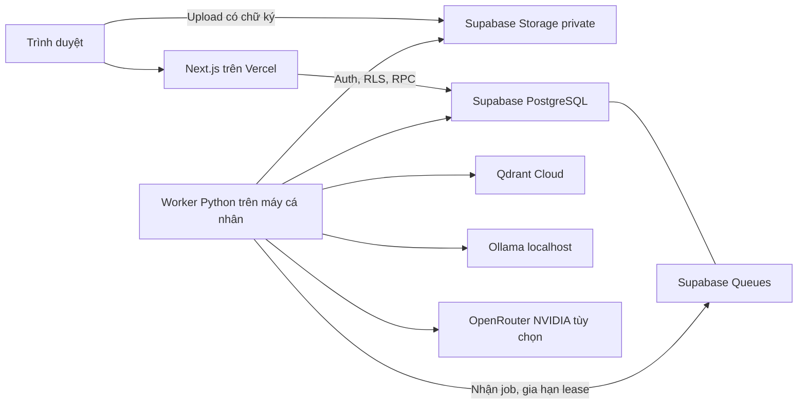

# LearnStep - Hiểu thêm mỗi ngày

[Bộ sơ đồ hệ thống](docs/system-diagrams.md): use case, kiến trúc, ERD,
sequence upload/RAG, kho tài liệu, trạng thái và hoạt động cộng đồng.

LearnStep là website hỗ trợ tự học Giải tích, Đại số tuyến tính và Vật lý đại cương bằng RAG và SLM. Sinh viên đăng nhập, tải PDF/DOCX, chọn tối đa 5 tài liệu, hỏi đáp tiếng Việt có LaTeX và nguồn trích dẫn, xem lại lịch sử.

[Streak theo ngày học](docs/streaks.md) ghi nhận chuỗi liên tiếp, kỷ lục và lịch
7 ngày theo giờ Việt Nam khi hoàn tất câu hỏi có nguồn.

[Kho tài liệu](docs/document-repository.md) có hai tab: tài liệu chung dùng
cho RAG và tài liệu người dùng tải lên. Trích dẫn mở đúng tài liệu và đoạn nguồn.

[Thông báo và nhóm học tập](docs/community.md) hỗ trợ trao đổi theo môn với
quyền thành viên riêng. [Giao diện học tập](docs/workspace.md) có lịch sử nhanh,
cài đặt và khung chat tập trung. Các thay đổi và phạm vi kiểm tra bảo mật được
ghi trong [báo cáo rà soát](docs/security-review.md).

## Kiến trúc



Worker chỉ kết nối ra ngoài; không mở cổng máy cá nhân. Vercel không chạy model và không chờ inference. API trả `202`, giao diện đọc trạng thái/câu trả lời mỗi 2 giây khi có việc, 15 giây khi nghỉ. AI cần worker đang chạy cùng Ollama hoặc kết nối OpenRouter. [Hướng dẫn dùng NVIDIA free qua OpenRouter, gồm embedding và rerank](docs/openrouter.md).

Có thể [dùng Ollama làm model chính và OpenRouter dự phòng cho câu trả lời](docs/chat-fallback.md).
Embedding vẫn là BGE-M3; OpenRouter chỉ được gọi khi model chat chính lỗi.

## Cấu trúc

```text
apps/web/                 Next.js, Auth, giao diện, API
services/worker/          Parser, embedding, Qdrant, RAG, đánh giá
supabase/migrations/     Schema, RLS, RPC, bucket và hàng đợi
tests/                   Kiểm thử PostgreSQL nhúng
docs/                    Triển khai, vận hành, đánh giá
```

## 1. Chuẩn bị

- Node.js 22 trở lên và npm; dùng `npm ci` để giữ đúng phiên bản trong lockfile.
- Python 3.12 hoặc 3.13 và [uv](https://docs.astral.sh/uv/).
- Supabase project mới, Qdrant Cloud cluster, [Ollama](https://ollama.com/download).
- Máy demo dự kiến: RTX 3060 Laptop 6 GB VRAM, RAM 16 GB. Chỉ một job AI chạy tại một thời điểm.

Không đưa secret vào Git. Hai file cấu hình dưới đây đã được `.gitignore` loại trừ.

## 2. Supabase và Qdrant

1. Tạo project Supabase riêng cho development. Dùng Supabase CLI: `supabase link --project-ref <ref>` rồi `supabase db push`. Nếu dùng SQL Editor trên project mới, chạy lần lượt các migration từ `202610220001_initial.sql` đến `202610300001_document_repository.sql` trong `supabase/migrations`, mỗi file một lần. Project đã có schema chỉ áp dụng các migration còn thiếu.
2. Migration tạo bucket private `documents`, extension PGMQ, queue `study_jobs`, các bảng và RPC. Không bật public bucket hoặc cấp quyền queue cho trình duyệt.
3. Trong Authentication bật email/password, xác nhận email, password tối thiểu 8 ký tự. Cấu hình Site URL `http://localhost:3000`; thêm redirect `http://localhost:3000/auth/callback` và `http://localhost:3000/auth/confirm`. Nếu dùng `127.0.0.1`, thêm URL tương ứng.
4. Lấy Project URL, publishable/anon key và service-role key từ Supabase. Lấy chuỗi kết nối **Session pooler port 5432** hoặc direct connection có SSL từ mục Connect. URL-encode mật khẩu. Không dùng transaction pooler port 6543: worker cần session advisory lock.
5. Tạo Qdrant Cloud cluster, lấy URL và API key. Worker tự tạo collection `study_bge_m3_v1` (1024 chiều, cosine) và payload indexes lúc khởi động.

Đường dẫn file có dạng `<user_uuid>/<document_uuid>.pdf` hoặc `.docx`. Client không có quyền ghi trực tiếp bảng nghiệp vụ hay queue. API cấp signed upload URL sau khi RPC kiểm tra quota; bucket không cho phép client sửa/ghi đè file đã tồn tại.

## 3. Chạy web

Từ thư mục gốc, PowerShell:

```powershell
Copy-Item apps/web/.env.example apps/web/.env.local
# Điền URL, anon key, service-role key vào file vừa tạo.
npm ci
npm run dev
```

Mở địa chỉ Local do Next.js in ra, mặc định `http://127.0.0.1:3000`. Đăng ký và xác nhận email. Nếu chưa có biến môi trường, trang chủ vẫn chạy và trang học tập hướng dẫn cấu hình.

Sau đăng ký, giao diện chuyển sang bước chọn username (3–24 ký tự, chữ cái
không dấu, số, `_`, bắt đầu bằng chữ cái). Nếu chưa xác nhận email, tên chỉ
được ghi nhớ trên thiết bị và chưa giữ chỗ. Sau xác nhận hoặc đăng nhập, người
dùng hoàn tất chọn tên trên `/onboarding` rồi vào `/study`. Tài khoản cũ chưa
có tên cũng được đưa qua bước này. Username duy nhất được lưu trong bảng
`profiles` có RLS; ứng dụng vẫn dùng email và mật khẩu để đăng nhập. Nút
`Hiện / Ẩn` mật khẩu có ở đăng ký, đăng nhập và đặt lại mật khẩu.

Nếu liên kết email được mở trên thiết bị khác, PKCE callback có thể thiếu code verifier. Có thể dùng email template với token hash: `{{ .SiteURL }}/auth/confirm?token_hash={{ .TokenHash }}&type=email` cho xác nhận tài khoản; dùng `type=recovery` cho đặt lại mật khẩu. Không thêm wildcard redirect rộng vào môi trường production.

## 4. Chạy AI và worker

```powershell
ollama pull qwen3:4b
ollama pull bge-m3
cd services/worker
Copy-Item .env.example .env
# Điền DATABASE_URL, Supabase URL/service-role key, Qdrant URL/API key.
uv sync --frozen --python 3.12
uv run learnstep-worker
```

Ollama desktop phải đang chạy tại `http://127.0.0.1:11434`. Không đặt `OLLAMA_HOST=0.0.0.0`. Lần khởi động đầu cần Internet để tải tokenizer `Qwen/Qwen3-4B`; có thể tải trước và đặt `TOKENIZER_PATH` tới file `tokenizer.json` trên máy.

Worker kiểm tra model đã cài, collection và session lock trước khi báo online. Model embedding được giải phóng trước khi chạy SLM và ngược lại. SLM dùng context 4096, tối đa 768 token trả lời, thinking tắt. Nếu hết bộ nhớ hoặc bị cắt ngang, câu trả lời không được đánh dấu hoàn tất.

Khởi chạy worker bằng terminal riêng và giữ máy không sleep trong buổi demo. Dừng bằng Ctrl+C; job còn lease sẽ được nhận lại sau khi lease hết hạn. Nếu một worker khác đang giữ khóa, tiến trình mới sẽ dừng thay vì chạy đồng thời.

## 5. Kiểm tra

```powershell
# Từ gốc repository
npm test
npm run typecheck
npm run build

cd services/worker
uv run pytest
uv run ruff check src tests
```

Kiểm thử database dùng PostgreSQL/PLpgSQL thật qua PGlite với schema Auth/Storage và `pgmq.create/send` thay thế tối thiểu. Kiểm thử này xác minh RLS, grants, transaction enqueue, quota và idempotency; không xác nhận dịch vụ Supabase hoặc PGMQ đang chạy thực tế. Kiểm thử vector dùng Qdrant in-memory. Kiểm thử inference dùng HTTP mock, không giả định đã benchmark model thật.

Hướng dẫn tiếp theo:

- [Báo cáo tính năng hiện tại của LearnStep (PDF)](output/pdf/LearnStep-Bao-cao-tinh-nang-hien-tai.pdf)
- [Deploy Vercel và vận hành](docs/deployment.md)
- [API, trạng thái và quyền truy cập](docs/architecture.md)
- [Bộ dữ liệu và nghiệm thu RAG](docs/evaluation.md)

## Giới hạn MVP

PDF/DOCX tối đa 20 MB, 20 tài liệu/tài khoản; PDF tối đa 200 trang. Chưa hỗ trợ OCR, tài liệu mã hóa, nhận dạng công thức trong ảnh hoặc khôi phục chính xác công thức bị parser làm mất cấu trúc. DOCX trích xuất đoạn văn/bảng và tiêu đề; trích dẫn theo mục/đoạn, không giả lập số trang. Worker giới hạn văn bản trích xuất 1 triệu ký tự và DOCX giải nén 80 MB.

Mỗi tài khoản có một câu hỏi đang chờ/chạy, tối đa 30 câu/giờ. Không có cam kết thời gian phản hồi trước khi benchmark. Kiểm tra nhãn nguồn bảo đảm trích dẫn thuộc context được phép; mức độ nguồn thực sự hỗ trợ câu trả lời vẫn cần đánh giá thủ công. OCR, đề ôn tập, cá nhân hóa và LoRA/QLoRA nằm ngoài MVP này.
