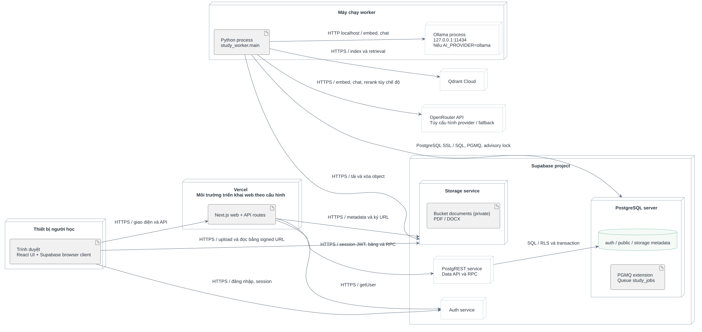

# Sơ đồ LearnStep



| Chủ đề | Sơ đồ và nguồn |
| --- | --- |
| Triển khai và thành phần | [Triển khai](01-deployment.svg) ([PlantUML](01-deployment.puml)), [thành phần](03-components.svg) ([PlantUML](03-components.puml)) |
| Use case | [Các chức năng và điều kiện thực hiện](use-cases.md) |
| Phân rã chức năng | [Bản khái quát, bản đầy đủ và đối chiếu mã](functional-decomposition.md) |
| Mô hình dữ liệu | [Tài liệu](04-erd.svg) ([PlantUML](04-erd.puml)), [hội thoại](04a-conversation-erd.svg) ([PlantUML](04a-conversation-erd.puml)), [cộng đồng](04b-community-erd.svg) ([PlantUML](04b-community-erd.puml)), [tài khoản và vận hành](04c-operations-erd.svg) ([PlantUML](04c-operations-erd.puml)) |
| Lưu trữ | [Bản đồ PostgreSQL, Storage và Qdrant](10-storage-map.svg) ([PlantUML](10-storage-map.puml)), [ví dụ đối tượng](09-object-snapshot.svg) ([PlantUML](09-object-snapshot.puml)) |
| Luồng xử lý | [Tải và index tài liệu](05-upload-sequence.svg) ([PlantUML](05-upload-sequence.puml)), [hỏi đáp RAG](06-rag-sequence.svg) ([PlantUML](06-rag-sequence.puml)), [chọn provider AI](11-provider-modes.svg) ([PlantUML](11-provider-modes.puml)), [công bố nguồn chung](12-publish-sequence.svg) ([PlantUML](12-publish-sequence.puml)) |
| Trạng thái và hoạt động | [Trạng thái tài liệu](07-document-states.svg) ([PlantUML](07-document-states.puml)), [đọc tài liệu hoặc hỏi đáp](08-library-activity.svg) ([PlantUML](08-library-activity.puml)) |

ERD dùng ký hiệu Crow’s Foot. PostgreSQL lưu dữ liệu và quyền, Supabase Storage lưu tệp PDF/DOCX, Qdrant lưu vector. Quan hệ giữa các dịch vụ thể hiện thông tin định vị, còn khóa ngoại nằm trong PostgreSQL. Xem thêm [pipeline RAG](../technique-relationships.md) và [quy trình quản lý kho chung](../document-repository.md).

## Tái tạo

Chạy từ thư mục gốc với Python, Java và [PlantUML](https://plantuml.com/download). Đặt `PLANTUML_JAR` trỏ tới file JAR, và `JAVA_BIN` trỏ tới Java nếu chưa có trong PATH. Script cập nhật ERD từ migration và xuất SVG.

```powershell
python docs/diagrams/generate.py
```

Khi cần ảnh PNG để chèn vào báo cáo, xuất từ SVG tại máy cá nhân.

```powershell
npm install --prefix .cache/diagram-renderer --no-audit --no-fund @resvg/resvg-js
node docs/diagrams/render.cjs
```

[Báo cáo rà soát sơ đồ tháng 10/2026](../diagram-review.md) ghi lại các quyết định ký pháp tại thời điểm rà soát.
