# Bộ sơ đồ LearnStep

Bộ kiến trúc đối chiếu mã ngày 30/10/2026; phân rã chức năng mở rộng ngày 02/11/2026. 27 hình hiện hành gồm 10 use case theo chức
năng, 14 sơ đồ kiến trúc, dữ liệu, hành vi và 3 bản phân rã chức năng. Nền trắng, không header/footer;
tên system boundary/node là một phần của ký pháp.

[Use case chi tiết theo chức năng](use-cases.md) · [Báo cáo rà soát](../diagram-review.md).

## Phân rã chức năng toàn hệ thống

[Bản khái quát, bản đầy đủ và bảng đối chiếu mã nguồn](functional-decomposition.md)
gồm 10 nhánh chính, 138 nút, bao gồm học theo tiến trình và tự học; xuất PNG/SVG nền sáng, không header/footer.

## Chọn sơ đồ

- [Triển khai dịch vụ](#1)
- [Use case chi tiết theo chức năng](#2)
- [Thành phần phần mềm](#3)
- [ERD tài liệu](#4)
- [ERD hội thoại và trích dẫn](#5)
- [ERD cộng đồng](#6)
- [ERD tài khoản và vận hành](#7)
- [Sequence upload và indexing](#8)
- [Sequence hỏi đáp RAG](#9)
- [State machine tài liệu](#10)
- [Activity đọc tài liệu hoặc hỏi đáp](#11)
- [Object diagram minh họa](#12)
- [Bản đồ lưu trữ](#13)
- [Activity chọn provider AI](#14)
- [Sequence công bố và thu hồi nguồn](#15)

<a id="1"></a>

## 1. Triển khai dịch vụ

UML deployment: node, artifact và kết nối theo giao thức. Thể hiện mô hình triển khai được cấu hình; chưa xác nhận cloud đang chạy.

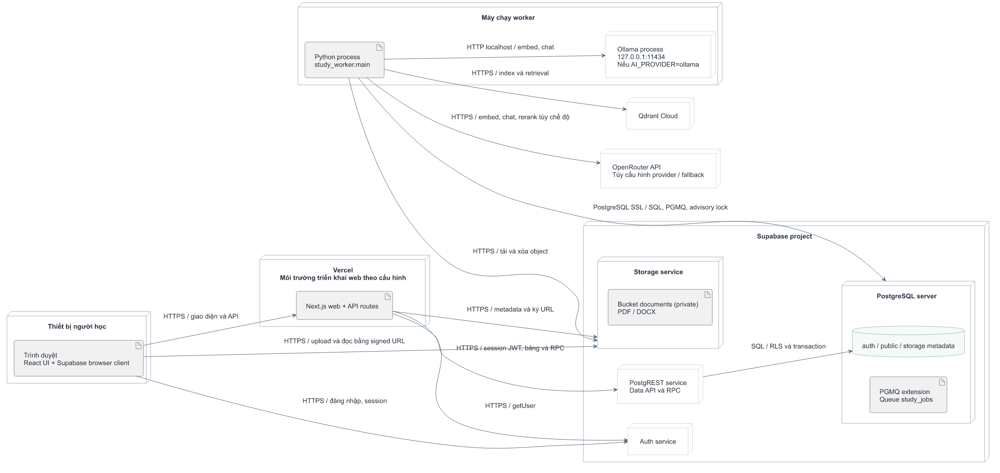

[SVG](01-deployment.svg) · [Nguồn PlantUML](01-deployment.puml)

<a id="2"></a>

## 2. Use case chi tiết theo chức năng

Đã thay hình toàn hệ thống bằng **10 sơ đồ riêng**: tài khoản, tài liệu cá nhân,
tài liệu chung, hỏi đáp, lịch sử, nhóm học, thông báo, hoạt động học, cài đặt và
vận hành công bố nguồn bằng SQL.

[Xem 10 sơ đồ và điều kiện từng chức năng](use-cases.md).
Mỗi hình có PNG, SVG và nguồn PlantUML, kèm mã use case và bằng chứng triển khai.
Các bản gộp cũ đã chuyển vào archive/system-use-cases.

<a id="3"></a>

## 3. Thành phần phần mềm

Dependency nét đứt đi từ thành phần sử dụng tới thành phần được sử dụng. Package là nhóm mô-đun; môi trường chạy được thể hiện ở deployment.

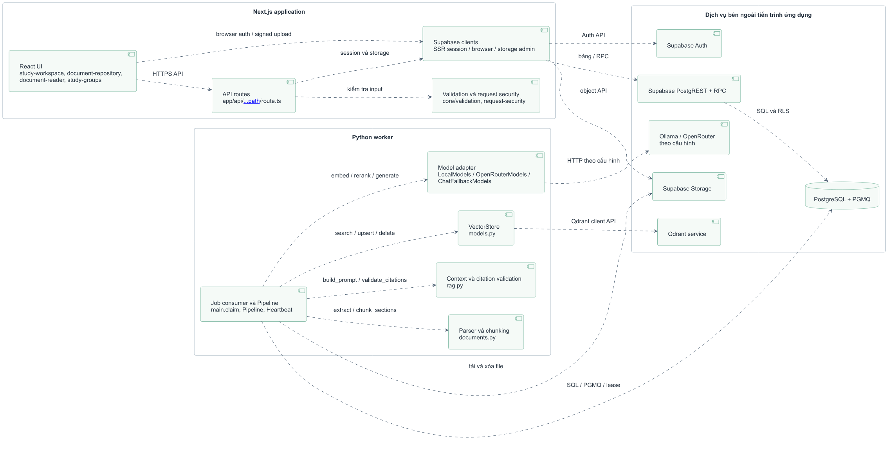

[SVG](03-components.svg) · [Nguồn PlantUML](03-components.puml)

<a id="4"></a>

## 4. ERD tài liệu

documents, document_chunks, knowledge_documents. Tài khoản có thể chưa có profile; công bố tài liệu không sao chép file.


[SVG](04-erd.svg) · [Nguồn PlantUML](04-erd.puml)

<a id="5"></a>

## 5. ERD hội thoại và trích dẫn

conversations, messages, message_sources. Chunk nguồn nullable sau khi xóa; user_id của message_sources là chủ hội thoại, có thể khác chủ tài liệu chung.

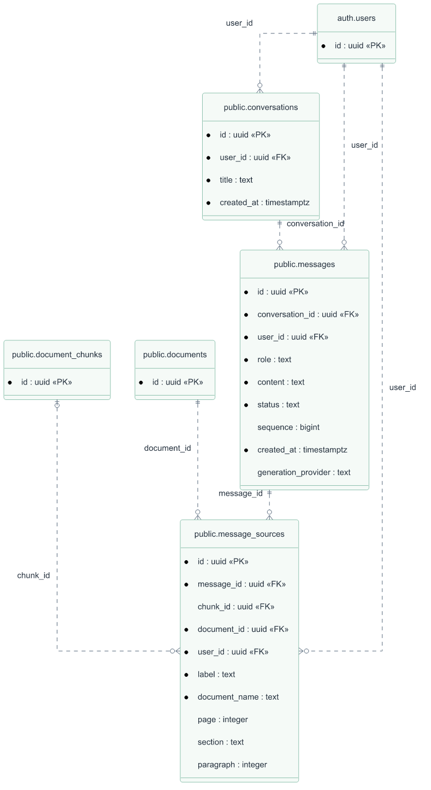

[SVG](04a-conversation-erd.svg) · [Nguồn PlantUML](04a-conversation-erd.puml)

<a id="6"></a>

## 6. ERD cộng đồng

study_groups, study_group_members, study_group_messages, notifications. Bảng thành viên giải quan hệ nhiều-nhiều giữa user và group.

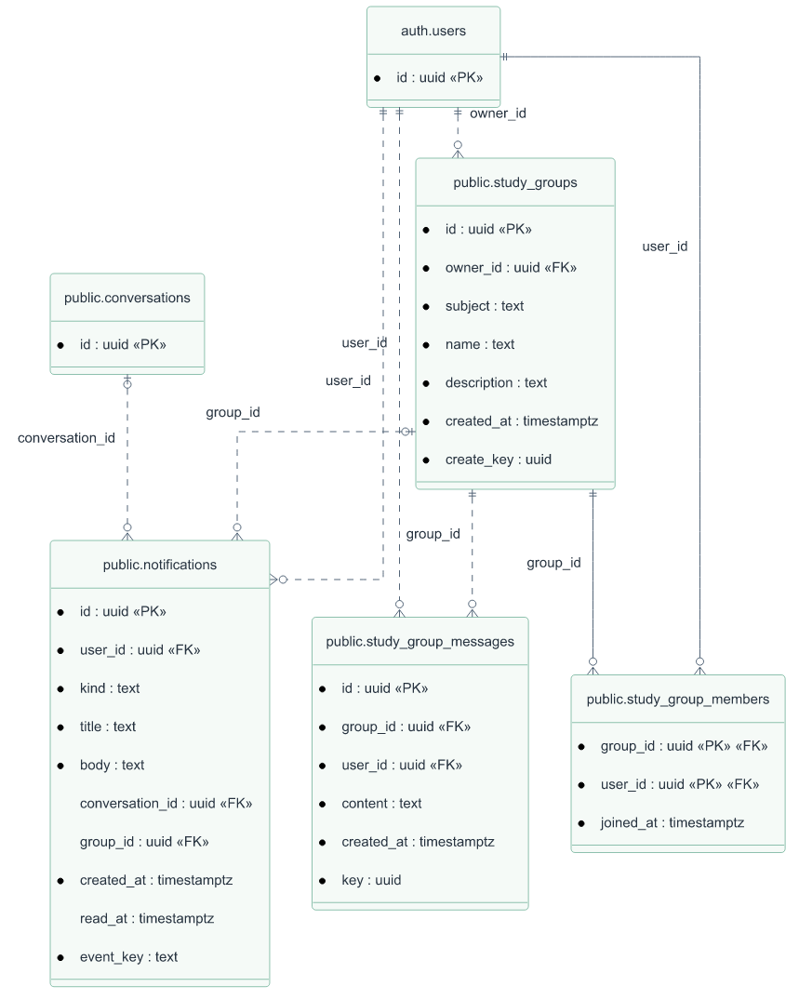

[SVG](04b-community-erd.svg) · [Nguồn PlantUML](04b-community-erd.puml)

<a id="7"></a>

## 7. ERD tài khoản và vận hành

profiles, study_activity_days, jobs, worker_heartbeats. Heartbeat độc lập; document_id và message_id của job đều nullable.

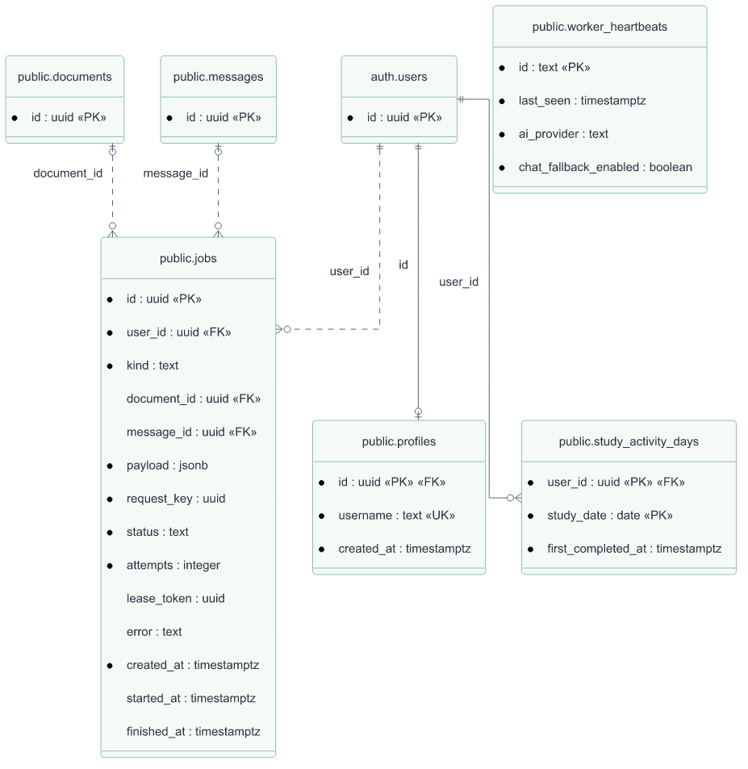

[SVG](04c-operations-erd.svg) · [Nguồn PlantUML](04c-operations-erd.puml)

<a id="8"></a>

## 8. Sequence upload và indexing

Tách PostgreSQL/PGMQ khỏi Storage; file đi trực tiếp từ browser tới Storage. Worker và polling chạy song song sau 202. Luồng ingest mô tả thành công; lỗi/retry xem state machine và mã main.fail.

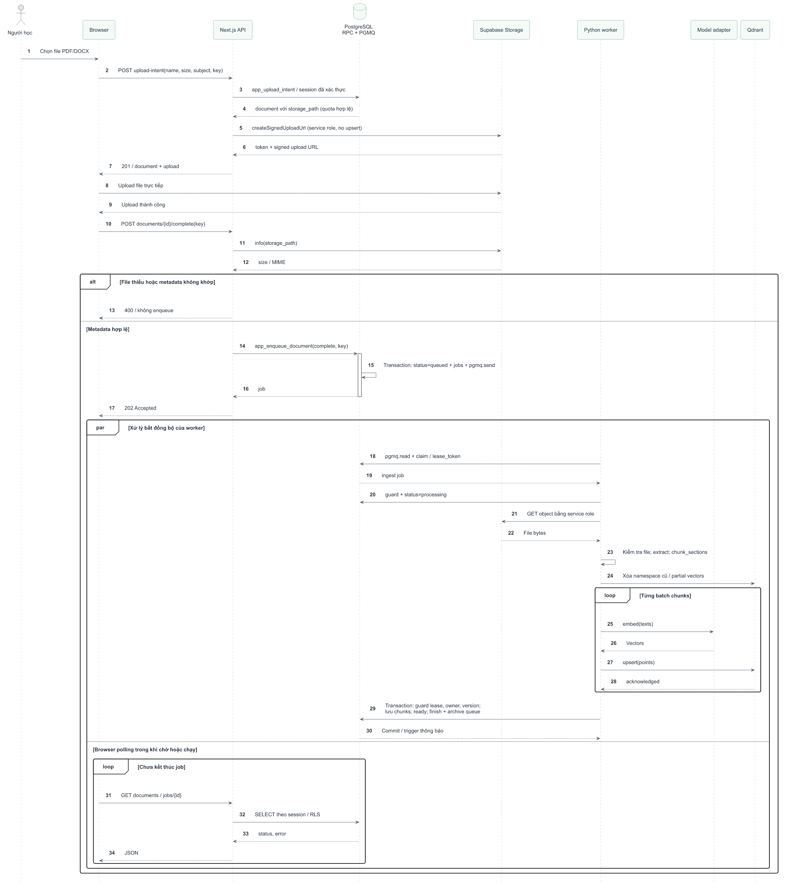

[SVG](05-upload-sequence.svg) · [Nguồn PlantUML](05-upload-sequence.puml)

<a id="9"></a>

## 9. Sequence hỏi đáp RAG

Truy xuất vector theo bộ owner/document/version; đọc lại canonical chunks. Có nhánh thiếu bằng chứng, rerank tùy chọn, partial flush và polling song song. Phân nhánh model ở hình Activity chọn provider AI.

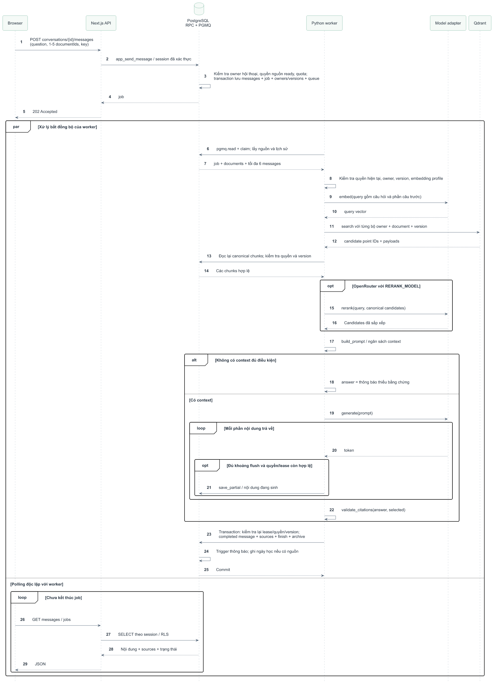

[SVG](06-rag-sequence.svg) · [Nguồn PlantUML](06-rag-sequence.puml)

<a id="10"></a>

## 10. State machine tài liệu

Tên trạng thái giữ đúng enum SQL. Có lỗi tạm thời quay queued, lỗi cuối sang failed và DELETE từ mọi trạng thái chưa xóa. deleted giữ tombstone, còn có thể dọn file trễ nên không nối tới final node.

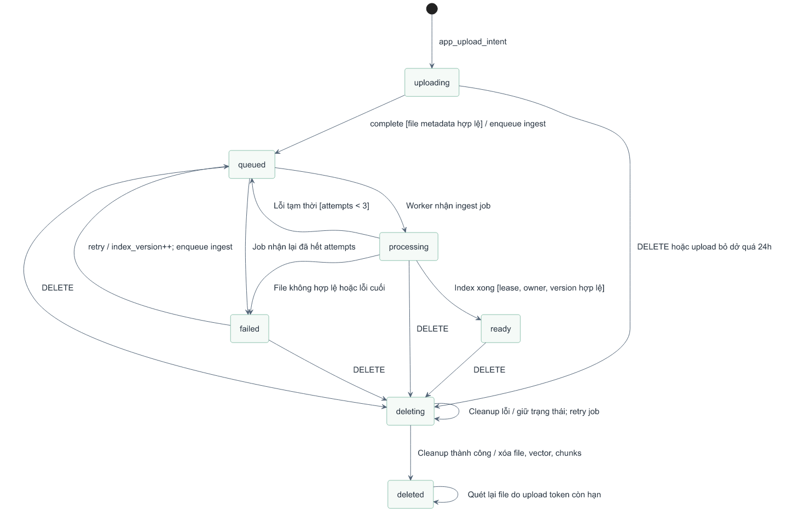

[SVG](07-document-states.svg) · [Nguồn PlantUML](07-document-states.puml)

<a id="11"></a>

## 11. Activity đọc tài liệu hoặc hỏi đáp

Decision/merge rõ ràng; không mặc định đọc tài liệu sẽ sinh trích dẫn. Hai hành động đọc và hỏi đáp là hai nhánh; có nhánh nguồn hoặc quyền không còn hợp lệ.

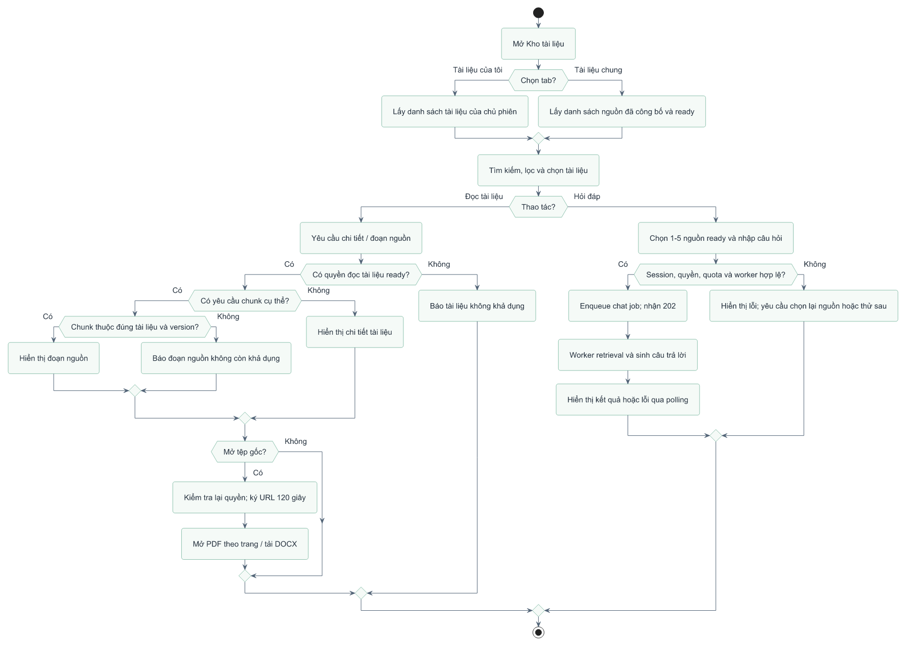

[SVG](08-library-activity.svg) · [Nguồn PlantUML](08-library-activity.puml)

<a id="12"></a>

## 12. Object diagram minh họa

Các instance có tên gạch chân và slot=value. Đây là phép chiếu mô hình dữ liệu thành instance minh họa, không khẳng định có các lớp Python/TypeScript cùng tên hoặc có dữ liệu U1/D1 thật.


[SVG](09-object-snapshot.svg) · [Nguồn PlantUML](09-object-snapshot.puml)

<a id="13"></a>

## 13. Bản đồ lưu trữ

PostgreSQL quan hệ, Supabase object storage và Qdrant vector database. Nét đứt là locator logic giữa dịch vụ; không phải FK hoặc replication tự động.


[SVG](10-storage-map.svg) · [Nguồn PlantUML](10-storage-map.puml)

<a id="14"></a>

## 14. Activity chọn provider AI

Ba chế độ cấu hình: Ollama; OpenRouter; Ollama với chat fallback. Đây là phân nhánh lựa chọn và đường xử lý thành công; lỗi provider đi qua xử lý job trong main.fail.

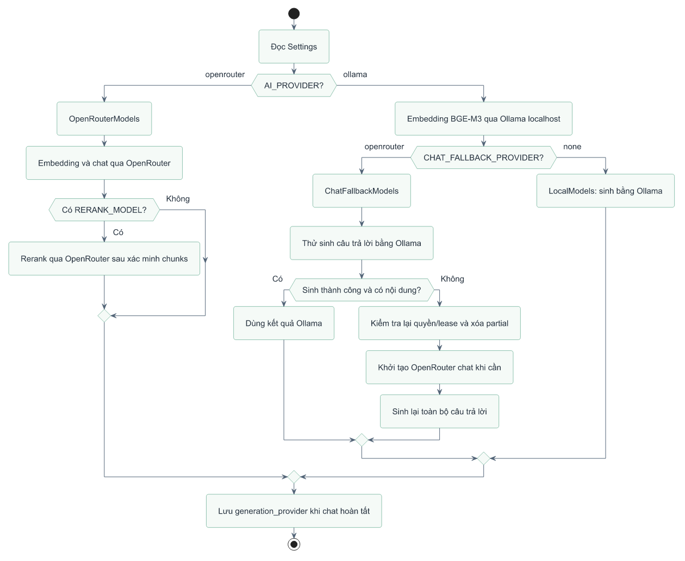

[SVG](11-provider-modes.svg) · [Nguồn PlantUML](11-provider-modes.puml)

<a id="15"></a>

## 15. Sequence công bố và thu hồi nguồn

Người vận hành thực hiện bằng SQL đặc quyền; chưa có web admin. Công bố khóa document và yêu cầu ready; worker kiểm tra lại quyền khi xử lý.

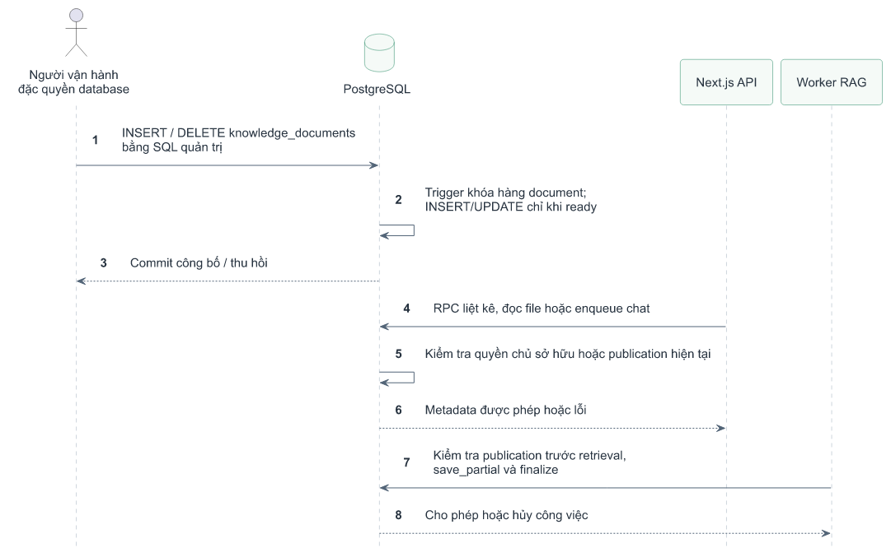

[SVG](12-publish-sequence.svg) · [Nguồn PlantUML](12-publish-sequence.puml)

## Cách đọc ERD

Crow's Foot: `||` đúng một, `o|` không hoặc một, `o{` không hoặc nhiều.
Dấu chấm tròn đầu thuộc tính biểu thị NOT NULL (ký hiệu `*` trong nguồn).
PK/FK/UK là khóa chính/khóa ngoại/khóa duy nhất một cột.
Quan hệ identifying dùng nét liền khi FK tham gia PK con; các FK còn lại dùng
nét đứt. Tên trên cạnh là cột FK ở bảng con. Bảng chỉ có id được lặp như tham
chiếu sang nhóm khác. Không dùng kiểu đường nối để suy ra quyền truy cập.

ERD được sinh từ CREATE TABLE và ADD COLUMN hiện có trong migration, bao phủ
14 bảng public và 24 FK. Các UNIQUE nhiều cột, partial index, CHECK, RLS và trigger
không được biểu diễn toàn bộ bằng hình; xem [báo cáo](../diagram-review.md).
Parser trong generate.py dành cho cấu trúc migration hiện tại, không phải SQL
parser tổng quát. auth.users được rút gọn thành id; nội bộ Storage/PGMQ do
Supabase quản lý không phải bảng nghiệp vụ public trong ERD.

## Tái tạo

Cần Java và [PlantUML](https://plantuml.com/download); bản đã dùng là 1.2026.9.
Trên Windows, bản JAR GPL có Graphviz đi kèm. JAR và JRE của phiên này nằm trong
.cache/plantuml (đã ignore), không ghi vào mã nguồn ứng dụng.
Có thể đặt JAVA_BIN trỏ java.exe, PLANTUML_JAR trỏ plantuml.jar của môi trường khác.

```powershell
python docs/diagrams/generate.py
npm install --prefix .cache/diagram-renderer --no-audit --no-fund @resvg/resvg-js
node docs/diagrams/render.cjs
```

Không chạy lại script SVG cũ: generate.py hiện dùng nguồn .puml và style.iuml.
Không thay đổi ứng dụng, schema hay dữ liệu khi tạo hình. Các sơ đồ không xác
nhận trạng thái triển khai hoặc kết quả inference thực tế.
