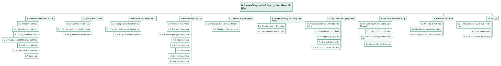
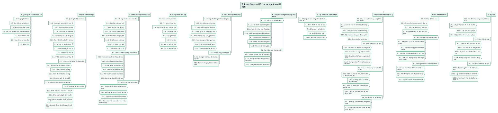

# Sơ đồ phân rã chức năng toàn hệ thống LearnStep

Cập nhật ngày 02/11/2026. Sơ đồ thiết kế tổng thể gồm **10 nhánh chính,
138 nút chức năng**, bao gồm Học theo tiến trình và Tự học.
Toàn bộ các nhánh dùng cùng ký pháp và màu xanh nhạt trên nền trắng.

## Bản khái quát



[SVG phóng to](13-functional-decomposition.svg) · [Nguồn PlantUML](13-functional-decomposition.puml).
Bản này dừng ở cấp 2 để thấy cấu trúc chung; những nhánh còn phân rã tiếp được
thể hiện đầy đủ trong bản chi tiết.

## Bản đầy đủ



[SVG phóng to](13a-functional-decomposition-detail.svg) ·
[Nguồn PlantUML](13a-functional-decomposition-detail.puml) ·
[Cây dữ liệu JSON](functional-decomposition.json).

## Phương thức học tập trong sơ đồ chính

- **9. Học theo tiến trình:** thiết lập lộ trình, học lần lượt theo bài/chặng,
  kiểm tra kết quả và điều chỉnh tiến trình.
- **10. Tự học:** xác định nội dung và mục tiêu tự học, ghi chú và luyện tập
  theo nhu cầu, ôn tập và theo dõi kết quả.

Hai nhánh nằm trực tiếp dưới chức năng gốc, ngang cấp với các phân hệ còn lại.
Kho tài liệu và trợ giảng được dùng chung; tiến độ bài học được theo dõi riêng
với chuỗi ngày hoạt động. [Mô tả phương thức học](learning-modes-proposal.md).

## Cách đọc và phạm vi

- Nút 0 là chức năng gốc. Nút 1–10 là phân hệ; mã 2.1 hoặc 2.1.1 cho biết
  chức năng con thuộc chức năng cha nào. Cạnh nối chỉ quan hệ phân rã cha–con;
  vị trí trái/phải không biểu thị trình tự, luồng dữ liệu hoặc quyền kế thừa.
- Các hộp dùng động từ/cụm chức năng. Đây là sơ đồ phân rã chức năng (FDD/BFD),
  không phải sơ đồ use case, DFD hoặc kiến trúc triển khai.
- Các nhánh 2.3, 3.3, 5.2, 6.2 và 8.2–8.4 là chức năng nội bộ hỗ trợ. Chúng
  không được hiểu là các màn hình hoặc nút mà người học có thể thao tác.
- 8.1 là quản lý công bố và thu hồi nguồn của tài khoản có quyền `content_manager`.
  Nhánh 2.2 là đọc và chọn nguồn chung của người học.
- Tài liệu cá nhân chỉ chủ sở hữu quản lý; nguồn chung cần được công bố và ready.
  Đọc/gửi tin nhóm yêu cầu là thành viên; chủ nhóm hiện chưa được rời nhóm.
- Hoàn tất hồ sơ chỉ chọn username ban đầu. Ngày học được ghi phía server khi
  hoàn tất chat có nguồn; người học không có chức năng tự điểm danh hoặc sửa lịch.
- Rerank và fallback chỉ chạy khi cấu hình tương ứng được bật. Kiểm tra nhãn
  trích dẫn không tự xác nhận nội dung trả lời là đúng về mặt ngữ nghĩa.
- Một số thao tác dùng cùng implementation ở nhiều ngữ cảnh (hỏi đáp mới và lịch
  sử) vẫn được thể hiện theo mục tiêu người dùng; không suy ra có hai dịch vụ riêng.

Sử dụng bộ dựng cây của [PlantUML](https://plantuml.com/wbs-diagram) để trình bày
phân cấp. Các nút ở đây là chức năng hệ thống, không phải công việc, tiến độ
hoặc gói bàn giao trong kế hoạch dự án. Phân nhóm là quyết định mô hình hóa
được đối chiếu với mã; không khẳng định đây là phân rã duy nhất có thể sử dụng.

## Đối chiếu với mã nguồn và use case

Bảng dưới liệt kê các nút lá cùng căn cứ mã nguồn hoặc tài liệu thiết kế. Mã use case tham chiếu
[bộ use case theo chức năng](use-cases.md); dấu — là chức năng nội bộ hoặc xử lý
server không được đặt thành use case người học riêng.

| Mã phân rã | Chức năng lá | Use case | Căn cứ |
|---|---|---|---|
| 1.1 | Đăng ký tài khoản | TK-01 | [auth-form.tsx](../../apps/web/src/components/auth-form.tsx), [username-setup.tsx](../../apps/web/src/components/username-setup.tsx) |
| 1.2 | Xác nhận email đăng ký | TK-02 | [auth-form.tsx](../../apps/web/src/components/auth-form.tsx), [username-setup.tsx](../../apps/web/src/components/username-setup.tsx) |
| 1.3 | Đăng nhập bằng email | TK-03 | [auth-form.tsx](../../apps/web/src/components/auth-form.tsx), [username-setup.tsx](../../apps/web/src/components/username-setup.tsx) |
| 1.4 | Yêu cầu liên kết khôi phục mật khẩu | TK-04 | [auth-form.tsx](../../apps/web/src/components/auth-form.tsx), [username-setup.tsx](../../apps/web/src/components/username-setup.tsx) |
| 1.5 | Đặt mật khẩu mới | TK-05 | [auth-form.tsx](../../apps/web/src/components/auth-form.tsx), [username-setup.tsx](../../apps/web/src/components/username-setup.tsx) |
| 1.6 | Hoàn tất hồ sơ ban đầu | TK-06 | [auth-form.tsx](../../apps/web/src/components/auth-form.tsx), [username-setup.tsx](../../apps/web/src/components/username-setup.tsx) |
| 1.7 | Đăng xuất | TK-07 | [auth-form.tsx](../../apps/web/src/components/auth-form.tsx), [username-setup.tsx](../../apps/web/src/components/username-setup.tsx) |
| 2.1.1 | Xem danh sách tài liệu của tôi | CN-01 | [document-repository.tsx](../../apps/web/src/components/document-repository.tsx) |
| 2.1.2 | Tra cứu tài liệu cá nhân | CN-02 | [document-repository.tsx](../../apps/web/src/components/document-repository.tsx) |
| 2.1.3 | Tải tài liệu cá nhân lên | CN-03 | [document-repository.tsx](../../apps/web/src/components/document-repository.tsx) |
| 2.1.4 | Xác nhận bản tải đang dở | CN-04 | [document-repository.tsx](../../apps/web/src/components/document-repository.tsx) |
| 2.1.5 | Theo dõi kết quả xử lý tài liệu | CN-05 | [document-repository.tsx](../../apps/web/src/components/document-repository.tsx) |
| 2.1.6 | Thử xử lý lại tài liệu lỗi | CN-06 | [document-repository.tsx](../../apps/web/src/components/document-repository.tsx) |
| 2.1.7 | Đọc tài liệu gốc của tôi | CN-07 | [document-repository.tsx](../../apps/web/src/components/document-repository.tsx) |
| 2.1.8 | Xóa tài liệu của tôi | CN-08 | [document-repository.tsx](../../apps/web/src/components/document-repository.tsx) |
| 2.1.9 | Thử xóa lại khi dọn tệp lỗi | CN-09 | [document-repository.tsx](../../apps/web/src/components/document-repository.tsx) |
| 2.2.1 | Xem danh mục tài liệu chung | CH-01 | [202610300001_document_repository.sql](../../supabase/migrations/202610300001_document_repository.sql) |
| 2.2.2 | Tra cứu tài liệu chung | CH-02 | [202610300001_document_repository.sql](../../supabase/migrations/202610300001_document_repository.sql) |
| 2.2.3 | Xem chi tiết tài liệu chung | CH-03 | [202610300001_document_repository.sql](../../supabase/migrations/202610300001_document_repository.sql) |
| 2.2.4 | Đọc tệp gốc đã công bố | CH-04 | [202610300001_document_repository.sql](../../supabase/migrations/202610300001_document_repository.sql) |
| 2.2.5 | Chọn nguồn chung cho câu hỏi | CH-05 | [202610300001_document_repository.sql](../../supabase/migrations/202610300001_document_repository.sql) |
| 2.3.1 | Trích xuất văn bản PDF / DOCX | — | [documents.py](../../services/worker/src/study_worker/documents.py), [main.py](../../services/worker/src/study_worker/main.py) |
| 2.3.2 | Chia đoạn và giữ vị trí nguồn | — | [documents.py](../../services/worker/src/study_worker/documents.py), [main.py](../../services/worker/src/study_worker/main.py) |
| 2.3.3 | Tạo embedding và ghi chỉ mục vector | — | [documents.py](../../services/worker/src/study_worker/documents.py), [main.py](../../services/worker/src/study_worker/main.py) |
| 2.3.4 | Lưu các đoạn văn bản và kết quả xử lý | — | [documents.py](../../services/worker/src/study_worker/documents.py), [main.py](../../services/worker/src/study_worker/main.py) |
| 3.1.1 | Bắt đầu hội thoại mới | HD-01 | [study-workspace.tsx](../../apps/web/src/components/study-workspace.tsx) |
| 3.1.2 | Chọn nguồn cho câu hỏi | HD-02 | [study-workspace.tsx](../../apps/web/src/components/study-workspace.tsx) |
| 3.1.3 | Gửi câu hỏi theo tài liệu | HD-03 | [study-workspace.tsx](../../apps/web/src/components/study-workspace.tsx) |
| 3.1.4 | Xem câu trả lời và trạng thái | HD-04 | [study-workspace.tsx](../../apps/web/src/components/study-workspace.tsx) |
| 3.1.5 | Hỏi tiếp trong hội thoại | HD-05 | [study-workspace.tsx](../../apps/web/src/components/study-workspace.tsx) |
| 3.1.6 | Đối chiếu trích dẫn | HD-06 | [study-workspace.tsx](../../apps/web/src/components/study-workspace.tsx) |
| 3.1.7 | Sao chép câu trả lời | HD-07 | [study-workspace.tsx](../../apps/web/src/components/study-workspace.tsx) |
| 3.2.1 | Xem danh sách hội thoại đã lưu | LS-01 | [study-workspace.tsx](../../apps/web/src/components/study-workspace.tsx) |
| 3.2.2 | Tìm hội thoại theo tiêu đề | LS-02 | [study-workspace.tsx](../../apps/web/src/components/study-workspace.tsx) |
| 3.2.3 | Đọc lại hội thoại đã chọn | LS-03 | [study-workspace.tsx](../../apps/web/src/components/study-workspace.tsx) |
| 3.2.4 | Tiếp tục hội thoại đã lưu | LS-04 | [study-workspace.tsx](../../apps/web/src/components/study-workspace.tsx) |
| 3.2.5 | Mở nguồn của câu trả lời cũ | LS-05 | [study-workspace.tsx](../../apps/web/src/components/study-workspace.tsx) |
| 3.2.6 | Sao chép câu trả lời đã lưu | LS-06 | [study-workspace.tsx](../../apps/web/src/components/study-workspace.tsx) |
| 3.3.1 | Truy xuất các đoạn nguồn được phép | — | [main.py](../../services/worker/src/study_worker/main.py), [rag.py](../../services/worker/src/study_worker/rag.py) |
| 3.3.2 | Sắp xếp lại nguồn khi bật rerank | — | [main.py](../../services/worker/src/study_worker/main.py), [rag.py](../../services/worker/src/study_worker/rag.py) |
| 3.3.3 | Tạo context và sinh câu trả lời | — | [main.py](../../services/worker/src/study_worker/main.py), [rag.py](../../services/worker/src/study_worker/rag.py) |
| 3.3.4 | Kiểm tra nhãn trích dẫn / báo thiếu bằng chứng | — | [main.py](../../services/worker/src/study_worker/main.py), [rag.py](../../services/worker/src/study_worker/rag.py) |
| 4.1 | Xem danh mục nhóm | NH-01 | [study-groups.tsx](../../apps/web/src/components/study-groups.tsx), [202610290001_community.sql](../../supabase/migrations/202610290001_community.sql) |
| 4.2 | Tìm nhóm theo môn | NH-02 | [study-groups.tsx](../../apps/web/src/components/study-groups.tsx), [202610290001_community.sql](../../supabase/migrations/202610290001_community.sql) |
| 4.3 | Xem thông tin giới thiệu nhóm | NH-03 | [study-groups.tsx](../../apps/web/src/components/study-groups.tsx), [202610290001_community.sql](../../supabase/migrations/202610290001_community.sql) |
| 4.4 | Tạo nhóm học | NH-04 | [study-groups.tsx](../../apps/web/src/components/study-groups.tsx), [202610290001_community.sql](../../supabase/migrations/202610290001_community.sql) |
| 4.5 | Tham gia nhóm | NH-05 | [study-groups.tsx](../../apps/web/src/components/study-groups.tsx), [202610290001_community.sql](../../supabase/migrations/202610290001_community.sql) |
| 4.6 | Rời nhóm | NH-06 | [study-groups.tsx](../../apps/web/src/components/study-groups.tsx), [202610290001_community.sql](../../supabase/migrations/202610290001_community.sql) |
| 4.7 | Đọc tin nhắn nhóm | NH-07 | [study-groups.tsx](../../apps/web/src/components/study-groups.tsx), [202610290001_community.sql](../../supabase/migrations/202610290001_community.sql) |
| 4.8 | Gửi tin nhắn nhóm | NH-08 | [study-groups.tsx](../../apps/web/src/components/study-groups.tsx), [202610290001_community.sql](../../supabase/migrations/202610290001_community.sql) |
| 5.1.1 | Xem tổng quan học tập | HT-01 | [study-overview.tsx](../../apps/web/src/components/study-overview.tsx), [study-streak.tsx](../../apps/web/src/components/study-streak.tsx) |
| 5.1.2 | Xem chuỗi ngày học hiện tại | HT-02 | [study-overview.tsx](../../apps/web/src/components/study-overview.tsx), [study-streak.tsx](../../apps/web/src/components/study-streak.tsx) |
| 5.1.3 | Xem kỷ lục và tổng ngày học | HT-03 | [study-overview.tsx](../../apps/web/src/components/study-overview.tsx), [study-streak.tsx](../../apps/web/src/components/study-streak.tsx) |
| 5.1.4 | Xem lịch học bảy ngày gần nhất | HT-04 | [study-overview.tsx](../../apps/web/src/components/study-overview.tsx), [study-streak.tsx](../../apps/web/src/components/study-streak.tsx) |
| 5.1.5 | Xem cách ghi nhận ngày học | HT-05 | [study-overview.tsx](../../apps/web/src/components/study-overview.tsx), [study-streak.tsx](../../apps/web/src/components/study-streak.tsx) |
| 5.1.6 | Xem số tài liệu sẵn sàng | HT-06 | [study-overview.tsx](../../apps/web/src/components/study-overview.tsx), [study-streak.tsx](../../apps/web/src/components/study-streak.tsx) |
| 5.1.7 | Xem số phiên học đã lưu | HT-07 | [study-overview.tsx](../../apps/web/src/components/study-overview.tsx), [study-streak.tsx](../../apps/web/src/components/study-streak.tsx) |
| 5.2.1 | Ghi ngày khi hoàn tất chat có nguồn | — | [202610220005_study_streaks.sql](../../supabase/migrations/202610220005_study_streaks.sql), [202610300001_document_repository.sql](../../supabase/migrations/202610300001_document_repository.sql) |
| 5.2.2 | Tính chuỗi ngày, kỷ lục và lịch tuần | — | [202610220005_study_streaks.sql](../../supabase/migrations/202610220005_study_streaks.sql), [202610300001_document_repository.sql](../../supabase/migrations/202610300001_document_repository.sql) |
| 6.1.1 | Xem danh sách thông báo | TB-01 | [notification-center.tsx](../../apps/web/src/components/notification-center.tsx) |
| 6.1.2 | Xem số thông báo chưa đọc | TB-02 | [notification-center.tsx](../../apps/web/src/components/notification-center.tsx) |
| 6.1.3 | Đánh dấu một thông báo đã đọc | TB-03 | [notification-center.tsx](../../apps/web/src/components/notification-center.tsx) |
| 6.1.4 | Đánh dấu tất cả đã đọc | TB-04 | [notification-center.tsx](../../apps/web/src/components/notification-center.tsx) |
| 6.1.5 | Mở hội thoại từ thông báo | TB-05 | [notification-center.tsx](../../apps/web/src/components/notification-center.tsx) |
| 6.1.6 | Mở nhóm từ thông báo | TB-06 | [notification-center.tsx](../../apps/web/src/components/notification-center.tsx) |
| 6.2.1 | Thông báo kết quả xử lý tài liệu | — | [202610290001_community.sql](../../supabase/migrations/202610290001_community.sql) |
| 6.2.2 | Thông báo kết quả / gián đoạn câu trả lời | — | [202610290001_community.sql](../../supabase/migrations/202610290001_community.sql) |
| 6.2.3 | Thông báo tin nhắn nhóm mới | — | [202610290001_community.sql](../../supabase/migrations/202610290001_community.sql) |
| 7.1 | Chọn giao diện sáng, tối hoặc theo thiết bị | CD-01 | [study-settings.tsx](../../apps/web/src/components/study-settings.tsx), [use-study-preferences.ts](../../apps/web/src/components/use-study-preferences.ts) |
| 7.2 | Điều chỉnh cỡ chữ lời giải | CD-02 | [study-settings.tsx](../../apps/web/src/components/study-settings.tsx), [use-study-preferences.ts](../../apps/web/src/components/use-study-preferences.ts) |
| 7.3 | Chọn phím gửi câu hỏi | CD-03 | [study-settings.tsx](../../apps/web/src/components/study-settings.tsx), [use-study-preferences.ts](../../apps/web/src/components/use-study-preferences.ts) |
| 7.4 | Bật hoặc tắt tự cuộn | CD-04 | [study-settings.tsx](../../apps/web/src/components/study-settings.tsx), [use-study-preferences.ts](../../apps/web/src/components/use-study-preferences.ts) |
| 7.5 | Khôi phục cài đặt mặc định | CD-05 | [study-settings.tsx](../../apps/web/src/components/study-settings.tsx), [use-study-preferences.ts](../../apps/web/src/components/use-study-preferences.ts) |
| 8.1.1 | Xem tài liệu đã sẵn sàng để công bố | VH-01 | [Trang quản lý kho](../../apps/web/src/app/admin/knowledge/page.tsx) |
| 8.1.2 | Công bố tài liệu vào kho chung | VH-02 | [RPC phân quyền](../../supabase/migrations/20261112150505_content_management.sql) |
| 8.1.3 | Thêm mô tả khi công bố | VH-03 | [Trang quản lý kho](../../apps/web/src/app/admin/knowledge/knowledge-manager.tsx) |
| 8.1.4 | Thu hồi công bố tài liệu | VH-04 | [RPC phân quyền](../../supabase/migrations/20261112150505_content_management.sql) |
| 8.2.1 | Tiếp nhận và nhận xử lý công việc | — | [main.py](../../services/worker/src/study_worker/main.py), [config.py](../../services/worker/src/study_worker/config.py), [fallback.py](../../services/worker/src/study_worker/fallback.py) |
| 8.2.2 | Giữ lease và cập nhật heartbeat | — | [main.py](../../services/worker/src/study_worker/main.py), [config.py](../../services/worker/src/study_worker/config.py), [fallback.py](../../services/worker/src/study_worker/fallback.py) |
| 8.2.3 | Thử lại khi lỗi / lưu trạng thái kết thúc | — | [main.py](../../services/worker/src/study_worker/main.py), [config.py](../../services/worker/src/study_worker/config.py), [fallback.py](../../services/worker/src/study_worker/fallback.py) |
| 8.2.4 | Chọn provider AI và fallback theo cấu hình | — | [main.py](../../services/worker/src/study_worker/main.py), [config.py](../../services/worker/src/study_worker/config.py), [fallback.py](../../services/worker/src/study_worker/fallback.py) |
| 8.3.1 | Kiểm tra chủ sở hữu, thành viên và nguồn công bố | — | [route.ts](../../apps/web/src/app/api/[[...path]]/route.ts), [202610220001_initial.sql](../../supabase/migrations/202610220001_initial.sql), [main.py](../../services/worker/src/study_worker/main.py) |
| 8.3.2 | Áp dụng quota và khóa idempotency | — | [route.ts](../../apps/web/src/app/api/[[...path]]/route.ts), [202610220001_initial.sql](../../supabase/migrations/202610220001_initial.sql), [main.py](../../services/worker/src/study_worker/main.py) |
| 8.3.3 | Kiểm tra phiên bản nguồn trước lưu kết quả | — | [route.ts](../../apps/web/src/app/api/[[...path]]/route.ts), [202610220001_initial.sql](../../supabase/migrations/202610220001_initial.sql), [main.py](../../services/worker/src/study_worker/main.py) |
| 8.3.4 | Cấp URL có thời hạn cho tệp được phép | — | [route.ts](../../apps/web/src/app/api/[[...path]]/route.ts), [202610220001_initial.sql](../../supabase/migrations/202610220001_initial.sql), [main.py](../../services/worker/src/study_worker/main.py) |
| 8.4.1 | Xóa tệp, vector và nội dung các đoạn | — | [main.py](../../services/worker/src/study_worker/main.py) |
| 8.4.2 | Dọn upload bỏ dở / quét lại tệp phát sinh trễ | — | [main.py](../../services/worker/src/study_worker/main.py) |
| 9.1.1 | Chọn môn học và mục tiêu đầu ra | — | [learning-modes-proposal.md](../../docs/diagrams/learning-modes-proposal.md) |
| 9.1.2 | Xác định kiến thức ban đầu | — | [learning-modes-proposal.md](../../docs/diagrams/learning-modes-proposal.md) |
| 9.1.3 | Lập kế hoạch và nhịp học phù hợp | — | [learning-modes-proposal.md](../../docs/diagrams/learning-modes-proposal.md) |
| 9.2.1 | Nhận thứ tự bài và kiến thức tiên quyết | — | [learning-modes-proposal.md](../../docs/diagrams/learning-modes-proposal.md) |
| 9.2.2 | Học nội dung gắn với tài liệu nguồn | — | [learning-modes-proposal.md](../../docs/diagrams/learning-modes-proposal.md) |
| 9.2.3 | Luyện tập và làm kiểm tra cuối bài | — | [learning-modes-proposal.md](../../docs/diagrams/learning-modes-proposal.md) |
| 9.2.4 | Chuyển chặng khi đạt điều kiện hoàn thành | — | [learning-modes-proposal.md](../../docs/diagrams/learning-modes-proposal.md) |
| 9.3.1 | Xem mức hoàn thành theo bài và chặng | — | [learning-modes-proposal.md](../../docs/diagrams/learning-modes-proposal.md) |
| 9.3.2 | Xác định phần kiến thức cần củng cố | — | [learning-modes-proposal.md](../../docs/diagrams/learning-modes-proposal.md) |
| 9.3.3 | Học bù và điều chỉnh kế hoạch | — | [learning-modes-proposal.md](../../docs/diagrams/learning-modes-proposal.md) |
| 10.1.1 | Lựa chọn chủ đề và tài liệu tự học | — | [learning-modes-proposal.md](../../docs/diagrams/learning-modes-proposal.md) |
| 10.1.2 | Đặt mục tiêu tự học | — | [learning-modes-proposal.md](../../docs/diagrams/learning-modes-proposal.md) |
| 10.1.3 | Lập kế hoạch thời gian tự học | — | [learning-modes-proposal.md](../../docs/diagrams/learning-modes-proposal.md) |
| 10.2.1 | Ghi chú gắn với đoạn tài liệu | — | [learning-modes-proposal.md](../../docs/diagrams/learning-modes-proposal.md) |
| 10.2.2 | Tạo tóm tắt và thẻ ghi nhớ | — | [learning-modes-proposal.md](../../docs/diagrams/learning-modes-proposal.md) |
| 10.2.3 | Tự kiểm tra kiến thức theo chủ đề | — | [learning-modes-proposal.md](../../docs/diagrams/learning-modes-proposal.md) |
| 10.2.4 | Hỏi trợ giảng theo nội dung đang học | — | [learning-modes-proposal.md](../../docs/diagrams/learning-modes-proposal.md) |
| 10.3.1 | Tự đánh giá mức độ đạt mục tiêu | — | [learning-modes-proposal.md](../../docs/diagrams/learning-modes-proposal.md) |
| 10.3.2 | Lập lịch ôn lại kiến thức cần nhớ | — | [learning-modes-proposal.md](../../docs/diagrams/learning-modes-proposal.md) |
| 10.3.3 | Xem lại ghi chú và các lần tự kiểm tra | — | [learning-modes-proposal.md](../../docs/diagrams/learning-modes-proposal.md) |

## Tái tạo

```powershell
python docs/diagrams/generate.py
node docs/diagrams/render.cjs
```

`functional-decomposition.py` tổng hợp các use case hiện hành cùng phạm vi
worker/RPC và hai phương thức học thành JSON và ba nguồn PlantUML. Sau đó generate.py dựng SVG và
render.cjs xuất PNG. Không có header/footer trang trí. Sơ đồ thể hiện phạm vi thiết kế tổng thể của hệ thống.
Các sơ đồ không xác nhận trạng thái các dịch vụ production đang hoạt động.
