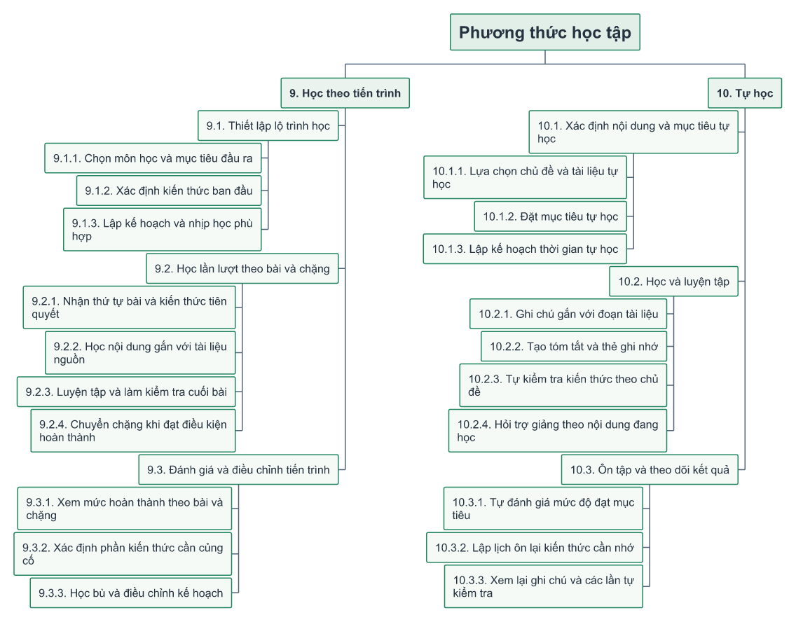

# Đề xuất học theo tiến trình và tự học chủ động

Hai nhánh 9 và 10 được bổ sung vào cây phân rã chức năng theo yêu cầu thiết kế.
Đây là các chức năng đang đề xuất, chưa được xác nhận triển khai trong mã nguồn.
Các hộp màu vàng nhạt mang trạng thái `proposed` trong cây JSON. Mã 1–8 được
giữ để tiếp tục đối chiếu các chức năng đã khảo sát trước đó.

[SVG phóng to](13b-learning-modes-proposal.svg) ·
[Toàn bộ cây chức năng](functional-decomposition.md).

## 9. Học theo tiến trình

Người học theo một lộ trình có mục tiêu, thứ tự bài và điều kiện hoàn thành.
Lộ trình gồm môn/chủ đề, chặng và bài học. Mỗi bài gắn nội dung nguồn, hoạt
động luyện tập và tiêu chí đánh giá; kiến thức tiên quyết xác định thứ tự học.

| Nhóm chức năng | Đề xuất hành vi |
|---|---|
| 9.1 Thiết lập lộ trình | Chọn môn và mục tiêu đầu ra; xác định kiến thức ban đầu bằng tự khai hoặc bài kiểm tra ngắn; đặt nhịp học theo thời gian có thể dành ra |
| 9.2 Học theo bài/chặng | Xem việc cần học tiếp; đọc nội dung gắn tài liệu; luyện tập, hỏi trợ giảng và kiểm tra cuối bài; chuyển chặng khi đáp ứng điều kiện |
| 9.3 Đánh giá và điều chỉnh | Xem bài đã hoàn thành, kết quả kiểm tra và phần kiến thức còn yếu; học bù hoặc điều chỉnh lịch trước khi tiếp tục |

Điều kiện hoàn thành nên rõ ràng theo từng bài, ví dụ hoàn thành hoạt động
bắt buộc và đạt ngưỡng bài kiểm tra. Ngưỡng là cấu hình thiết kế chưa chốt,
không mặc định cứ mở tài liệu hoặc gửi câu hỏi là đã nắm kiến thức. Khi chưa
đạt, đề xuất phần cần ôn và cho thử lại; có thể điều chỉnh tốc độ học.

## 10. Tự học

Người học tự lựa chọn chủ đề, tài liệu, mục tiêu và thời gian học; tự quyết
định thứ tự cũng như nhịp học. Phân hệ kết hợp đọc tài liệu, ghi chú, luyện
tập, hỏi trợ giảng và ôn tập để theo dõi mức độ đạt mục tiêu theo thời gian.

| Nhóm chức năng | Đề xuất hành vi |
|---|---|
| 10.1 Xác định nội dung và mục tiêu tự học | Lựa chọn chủ đề và tài liệu; đặt mục tiêu; lập kế hoạch thời gian phù hợp và điều chỉnh khi cần |
| 10.2 Học và luyện tập | Ghi chú theo đoạn nguồn; tạo tóm tắt/thẻ ghi nhớ; làm câu hỏi tự kiểm tra; hỏi trợ giảng với ngữ cảnh nội dung đang học |
| 10.3 Ôn tập và theo dõi kết quả | Tự đánh giá mức độ đạt mục tiêu; lập lịch ôn lại; xem ghi chú và kết quả các lần tự kiểm tra |

Tóm tắt, thẻ ghi nhớ hoặc câu hỏi có thể do người học tạo; nếu bổ sung hỗ trợ
AI thì cần cho người học xem và sửa trước khi lưu. Lịch ôn có thể bắt đầu từ
lịch do người học đặt; thuật toán giãn cách thích nghi là hướng mở rộng,
chưa được coi là thành phần đã có.

## Liên kết với các phân hệ còn lại

| Phân hệ | Cách kết nối hai nhánh mới |
|---|---|
| 2. Kho tài liệu | Dùng cùng tài liệu riêng/đã công bố và vị trí đoạn nguồn; chọn phương thức học không cấp thêm quyền đọc |
| 3. Hỏi đáp và hội thoại | Dùng chung trợ giảng; bổ sung ngữ cảnh bài học/chủ đề tự học và lưu liên kết để mở lại. “Hỏi trợ giảng theo nội dung đang học” là điểm tích hợp đề xuất quanh chức năng hỏi đáp hiện có |
| 5. Hoạt động học | Mở rộng trang tổng quan với bài tiếp theo, mục tiêu tự học và kết quả luyện tập. Tiến độ kiến thức cần dữ liệu đánh giá mới; streak hiện tại vẫn là chỉ số ngày hoạt động riêng |
| 6. Thông báo | Có thể bổ sung nhắc lịch bài học hoặc lịch ôn qua thông báo trong ứng dụng, chỉ khi người học bật và đặt lịch. Loại thông báo này vẫn là đề xuất, chưa có trong các event hiện tại |
| 7. Cài đặt | Có thể thêm nhịp học và lựa chọn nhắc ôn. Cấu hình hiện có chỉ gồm giao diện, chữ, phím gửi và tự cuộn |
| 8. Vận hành và bảo vệ | Nội dung lộ trình cần người có quyền biên soạn/công bố; ghi chú, mục tiêu, kết quả kiểm tra và tiến trình thuộc từng người học, cần kiểm soát truy cập khi triển khai |

Không cần tạo kho tài liệu thứ ba hoặc một chatbot riêng cho mỗi phương thức.
Phân rã vẫn là cây cha–con; các liên kết dùng chung được giải thích bằng bảng
trên để tránh biến sơ đồ thành luồng xử lý có nhiều cạnh chéo.

## Phạm vi thiết kế trước khi triển khai

Các khái niệm mới cần đặc tả dữ liệu: lộ trình, chặng, bài học, điều kiện tiên
quyết, đăng ký lộ trình, kết quả đánh giá, tiến trình cá nhân, kế hoạch tự học,
mục tiêu, ghi chú theo nguồn, thẻ ghi nhớ và lịch ôn. Đây là khái niệm đề xuất;
chưa tạo bảng SQL hoặc chỉnh ERD hiện trạng trong lần cập nhật này.

Ưu tiên một lộ trình mẫu có thứ tự cố định, bài kiểm tra ngắn và ghi tiến độ;
với tự học, ưu tiên mục tiêu tự học, ghi chú và tự kiểm tra. Sau khi có dữ
liệu sử dụng mới xem xét tự động gợi ý lộ trình, điều chỉnh độ khó hoặc lịch
ôn thích nghi. Điểm cần chốt tiếp là ai biên soạn nội dung, tiêu chí qua bài,
cách chấm câu hỏi tự luận và mức tùy chỉnh mà người học được phép thực hiện.
