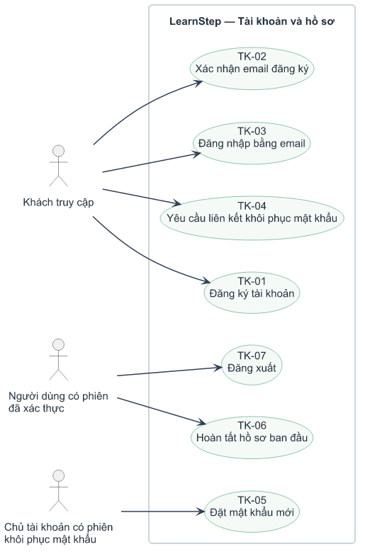
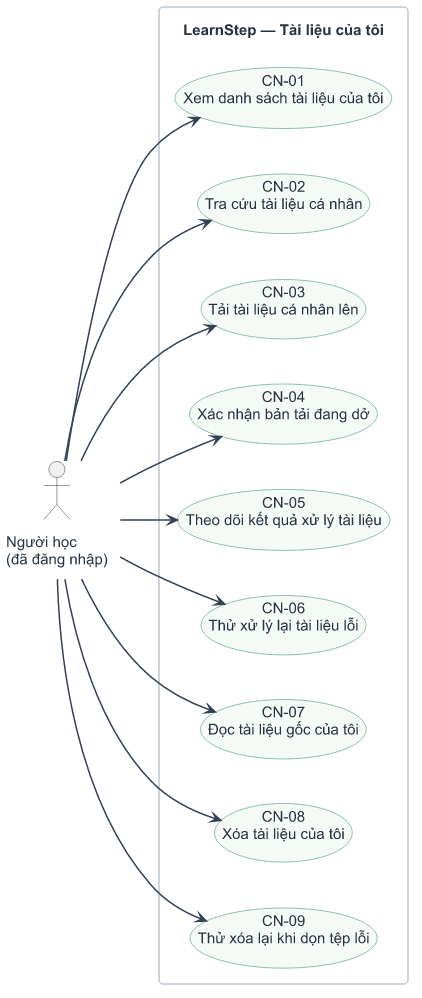
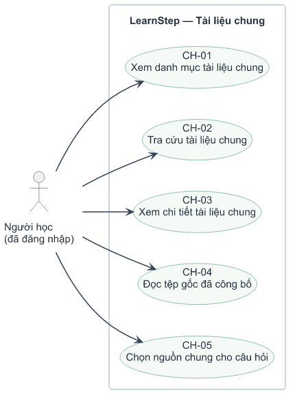
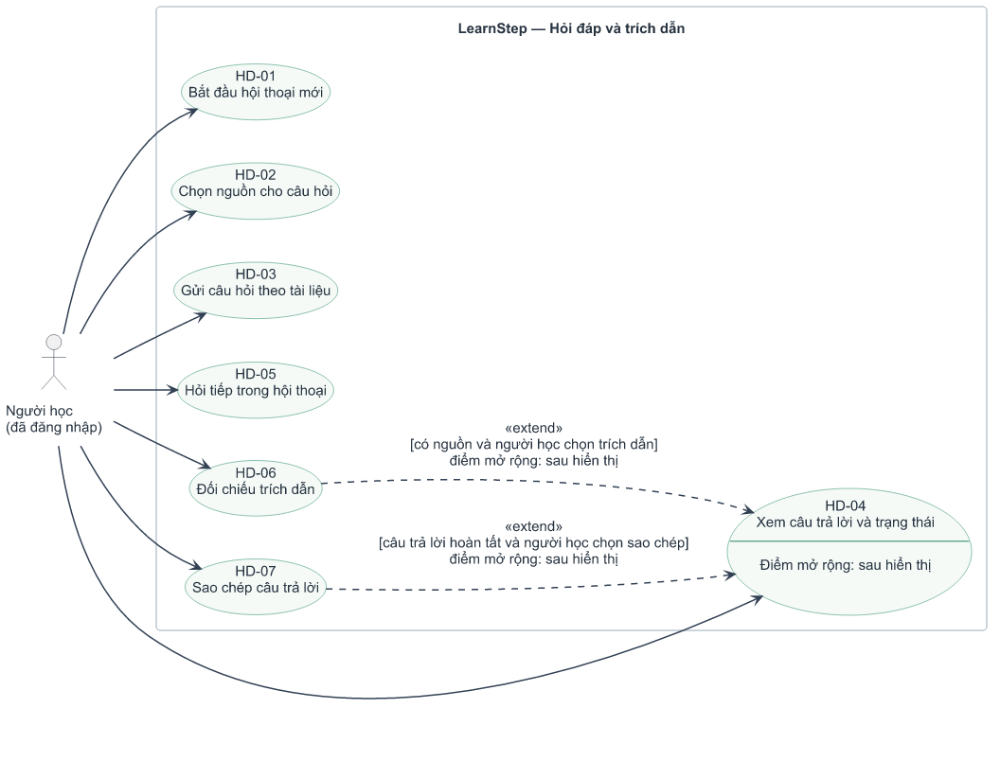
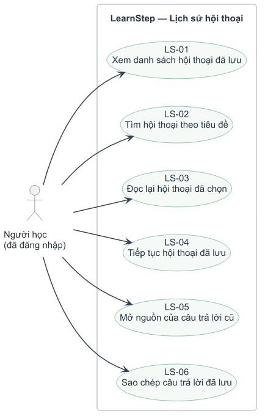
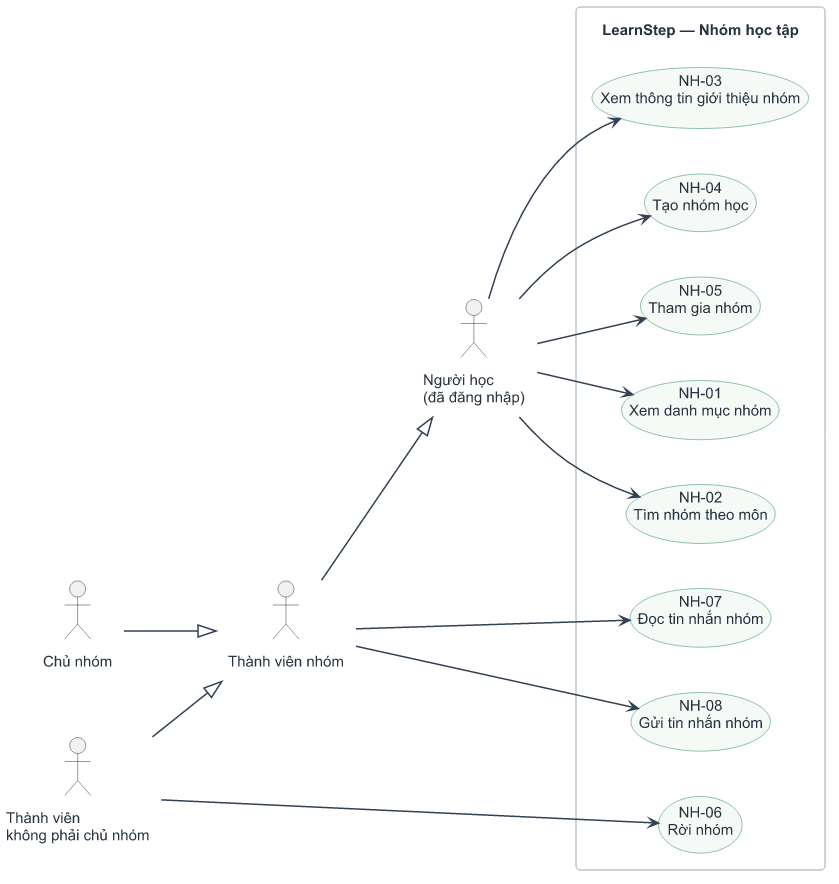
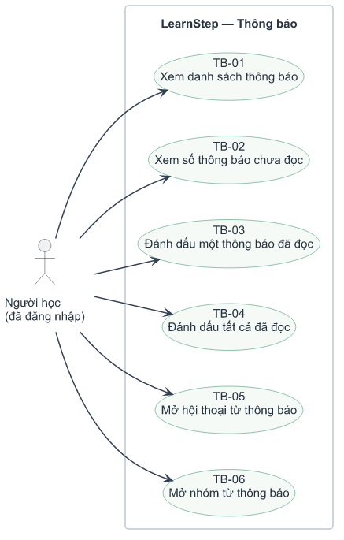
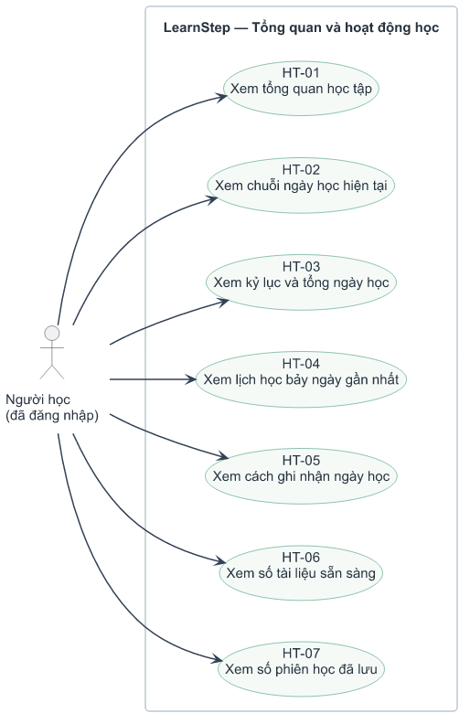
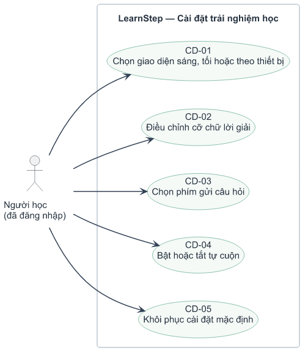
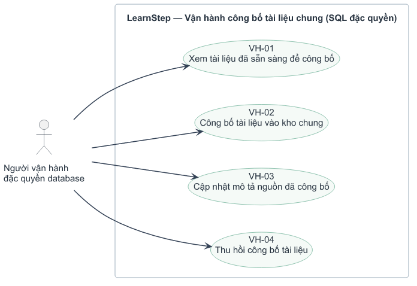

# Use case chi tiết theo chức năng

Bộ này thay thế các hình use case gộp toàn hệ thống. Mỗi hình chỉ mô tả một
nhóm chức năng và các mục tiêu/thao tác người dùng hiện có. Nền trắng, không
header/footer. Actor chỉ liên kết tới chức năng được phép; điều kiện trạng thái
được ghi bên dưới thay vì vẽ thành use case kiểm tra nội bộ.

Có 9 sơ đồ chức năng người dùng và 1 sơ đồ vận hành SQL riêng. Mũi tên nét
liền từ actor tới use case biểu thị hướng tương tác theo quy ước trình bày
của bộ này, không phải thứ tự thực hiện các chức năng. UML không bắt buộc mọi
association phải có mũi tên. Tam giác rỗng hướng tới actor tổng quát là
generalization; mũi tên nét đứt extend hướng từ thao tác tùy chọn tới use case
được mở rộng. Các loại đầu mũi tên được giữ riêng theo ý nghĩa quan hệ.
Không dùng include/extend để biểu diễn thứ tự các bước thao tác.

- [Tài khoản và hồ sơ](#1)
- [Tài liệu của tôi](#2)
- [Tài liệu chung](#3)
- [Hỏi đáp và trích dẫn](#4)
- [Lịch sử hội thoại](#5)
- [Nhóm học tập](#6)
- [Thông báo](#7)
- [Tổng quan và hoạt động học](#8)
- [Cài đặt trải nghiệm học](#9)
- [Vận hành công bố tài liệu chung (SQL đặc quyền)](#10)

## 1. Tài khoản và hồ sơ

[SVG](02a-account-use-cases.svg) · [Nguồn PlantUML](02a-account-use-cases.puml)

| Mã | Chức năng |
|---|---|
| TK-01 | Đăng ký tài khoản |
| TK-02 | Xác nhận email đăng ký |
| TK-03 | Đăng nhập bằng email |
| TK-04 | Yêu cầu liên kết khôi phục mật khẩu |
| TK-05 | Đặt mật khẩu mới |
| TK-06 | Hoàn tất hồ sơ ban đầu |
| TK-07 | Đăng xuất |

**Điều kiện và giới hạn:** TK-02 cần token xác nhận hợp lệ; TK-05 cần phiên recovery. TK-06 chỉ thiết lập username ban đầu cho tài khoản chưa có hồ sơ; không có chức năng đổi/quản trị username. Không nối signup include login vì hai kịch bản có thể ở các phiên khác nhau.

**Bằng chứng:** [auth-form.tsx](../../apps/web/src/components/auth-form.tsx), [route.ts](../../apps/web/src/app/auth/confirm/route.ts), [username-setup.tsx](../../apps/web/src/components/username-setup.tsx), [202610220002_profiles.sql](../../supabase/migrations/202610220002_profiles.sql).

## 2. Tài liệu của tôi

[SVG](02b-personal-document-use-cases.svg) · [Nguồn PlantUML](02b-personal-document-use-cases.puml)

| Mã | Chức năng |
|---|---|
| CN-01 | Xem danh sách tài liệu của tôi |
| CN-02 | Tra cứu tài liệu cá nhân |
| CN-03 | Tải tài liệu cá nhân lên |
| CN-04 | Xác nhận bản tải đang dở |
| CN-05 | Theo dõi kết quả xử lý tài liệu |
| CN-06 | Thử xử lý lại tài liệu lỗi |
| CN-07 | Đọc tài liệu gốc của tôi |
| CN-08 | Xóa tài liệu của tôi |
| CN-09 | Thử xóa lại khi dọn tệp lỗi |

**Điều kiện và giới hạn:** CN-02 gồm tìm tên/môn, lọc môn/trạng thái và sắp xếp. CN-04 chỉ khi uploading; CN-06 khi failed; CN-07 khi ready; CN-09 khi deleting có lỗi. Chỉ chủ sở hữu quản lý; upload PDF/DOCX tối đa 20 MB, tối đa 20 tài liệu. AI cần worker online; xóa vẫn enqueue được khi worker offline.

**Bằng chứng:** [document-repository.tsx](../../apps/web/src/components/document-repository.tsx), [route.ts](../../apps/web/src/app/api/[[...path]]/route.ts), [202610220001_initial.sql](../../supabase/migrations/202610220001_initial.sql).

## 3. Tài liệu chung

[SVG](02c-shared-document-use-cases.svg) · [Nguồn PlantUML](02c-shared-document-use-cases.puml)

| Mã | Chức năng |
|---|---|
| CH-01 | Xem danh mục tài liệu chung |
| CH-02 | Tra cứu tài liệu chung |
| CH-03 | Xem chi tiết tài liệu chung |
| CH-04 | Đọc tệp gốc đã công bố |
| CH-05 | Chọn nguồn chung cho câu hỏi |

**Điều kiện và giới hạn:** Chỉ nguồn đã công bố và ready được liệt kê/đọc/chọn. CH-02 gồm tìm kiếm, lọc và sắp xếp. Tổng nguồn chung và nguồn riêng cho một câu hỏi là 1–5. Người học không được tự công bố tài liệu vào kho chung. Signed URL đã cấp có thể còn hiệu lực tới 120 giây sau khi thu hồi.

**Bằng chứng:** [document-repository.tsx](../../apps/web/src/components/document-repository.tsx), [document-reader.tsx](../../apps/web/src/components/document-reader.tsx), [202610300001_document_repository.sql](../../supabase/migrations/202610300001_document_repository.sql).

## 4. Hỏi đáp và trích dẫn

[SVG](02d-rag-use-cases.svg) · [Nguồn PlantUML](02d-rag-use-cases.puml)

| Mã | Chức năng |
|---|---|
| HD-01 | Bắt đầu hội thoại mới |
| HD-02 | Chọn nguồn cho câu hỏi |
| HD-03 | Gửi câu hỏi theo tài liệu |
| HD-04 | Xem câu trả lời và trạng thái |
| HD-05 | Hỏi tiếp trong hội thoại |
| HD-06 | Đối chiếu trích dẫn |
| HD-07 | Sao chép câu trả lời |

**Điều kiện và giới hạn:** HD-02 chọn 1–5 nguồn ready có quyền đọc. HD-03/05 yêu cầu worker online, tối đa 2.000 ký tự/câu, một chat job đang hoạt động/user, 30 câu/giờ. HD-06 mở đúng document/chunk và có thể mở tệp gốc; nguồn đã mất được báo không khả dụng. extend mô tả thao tác tùy chọn tại sau hiển thị, không khẳng định mọi câu trả lời có trích dẫn. Không thêm thao tác hủy job hoặc nút tạo lại câu trả lời vì chưa có.

**Bằng chứng:** [study-workspace.tsx](../../apps/web/src/components/study-workspace.tsx), [document-reader.tsx](../../apps/web/src/components/document-reader.tsx), [main.py](../../services/worker/src/study_worker/main.py), [rag.py](../../services/worker/src/study_worker/rag.py).

## 5. Lịch sử hội thoại

[SVG](02e-history-use-cases.svg) · [Nguồn PlantUML](02e-history-use-cases.puml)

| Mã | Chức năng |
|---|---|
| LS-01 | Xem danh sách hội thoại đã lưu |
| LS-02 | Tìm hội thoại theo tiêu đề |
| LS-03 | Đọc lại hội thoại đã chọn |
| LS-04 | Tiếp tục hội thoại đã lưu |
| LS-05 | Mở nguồn của câu trả lời cũ |
| LS-06 | Sao chép câu trả lời đã lưu |

**Điều kiện và giới hạn:** Chỉ đọc hội thoại của chủ phiên; API lấy tối đa 100 phiên mới nhất. LS-02 ở danh sách nhanh trên sidebar và tổng quan. LS-04 có cùng điều kiện gửi câu hỏi của HD-03. LS-05 kiểm tra quyền/version hiện tại, không mặc định nguồn cũ luôn khả dụng. Chưa có đổi tên, xóa hay chia sẻ hội thoại.

**Bằng chứng:** [study-workspace.tsx](../../apps/web/src/components/study-workspace.tsx), [study-overview.tsx](../../apps/web/src/components/study-overview.tsx), [route.ts](../../apps/web/src/app/api/[[...path]]/route.ts).

## 6. Nhóm học tập

[SVG](02f-study-group-use-cases.svg) · [Nguồn PlantUML](02f-study-group-use-cases.puml)

| Mã | Chức năng |
|---|---|
| NH-01 | Xem danh mục nhóm |
| NH-02 | Tìm nhóm theo môn |
| NH-03 | Xem thông tin giới thiệu nhóm |
| NH-04 | Tạo nhóm học |
| NH-05 | Tham gia nhóm |
| NH-06 | Rời nhóm |
| NH-07 | Đọc tin nhắn nhóm |
| NH-08 | Gửi tin nhắn nhóm |

**Điều kiện và giới hạn:** Vai trò được hiểu trong ngữ cảnh từng nhóm: chủ nhóm là thành viên, nhưng không kế thừa quyền rời nhóm của N. NH-05 chỉ khi chưa tham gia, NH-06 khi là thành viên không phải chủ. Chưa có chuyển chủ, xóa nhóm hay sửa tin nhắn. Mỗi user tối đa sở hữu 5 nhóm, tham gia 20 nhóm; mỗi nhóm tối đa 50 thành viên; 30 tin/phút/user. Tư cách thành viên không cấp quyền đọc tài liệu/hội thoại riêng của người khác.

**Bằng chứng:** [study-groups.tsx](../../apps/web/src/components/study-groups.tsx), [202610290001_community.sql](../../supabase/migrations/202610290001_community.sql).

## 7. Thông báo

[SVG](02g-notification-use-cases.svg) · [Nguồn PlantUML](02g-notification-use-cases.puml)

| Mã | Chức năng |
|---|---|
| TB-01 | Xem danh sách thông báo |
| TB-02 | Xem số thông báo chưa đọc |
| TB-03 | Đánh dấu một thông báo đã đọc |
| TB-04 | Đánh dấu tất cả đã đọc |
| TB-05 | Mở hội thoại từ thông báo |
| TB-06 | Mở nhóm từ thông báo |

**Điều kiện và giới hạn:** Danh sách tối đa 50 thông báo mới nhất, chỉ của chủ phiên. Chọn một thông báo đánh dấu đã đọc rồi mở đích nếu có conversation_id/group_id. TB-05/06 chỉ khi thông báo có đích tương ứng và người dùng còn quyền truy cập. Số chưa đọc là tổng truy vấn, không chỉ 50 mục. Đây là thông báo trong ứng dụng; chưa có email/push hoặc tự tạo thông báo từ người dùng.

**Bằng chứng:** [notification-center.tsx](../../apps/web/src/components/notification-center.tsx), [route.ts](../../apps/web/src/app/api/[[...path]]/route.ts), [202610290001_community.sql](../../supabase/migrations/202610290001_community.sql).

## 8. Tổng quan và hoạt động học

[SVG](02h-learning-activity-use-cases.svg) · [Nguồn PlantUML](02h-learning-activity-use-cases.puml)

| Mã | Chức năng |
|---|---|
| HT-01 | Xem tổng quan học tập |
| HT-02 | Xem chuỗi ngày học hiện tại |
| HT-03 | Xem kỷ lục và tổng ngày học |
| HT-04 | Xem lịch học bảy ngày gần nhất |
| HT-05 | Xem cách ghi nhận ngày học |
| HT-06 | Xem số tài liệu sẵn sàng |
| HT-07 | Xem số phiên học đã lưu |

**Điều kiện và giới hạn:** Ngày học được server ghi khi hoàn tất chat có câu trả lời kèm nguồn, theo Asia/Ho_Chi_Minh, mỗi ngày một lần. Người học chỉ xem, không có nút điểm danh hay sửa lịch. HT-06/07 dùng tập dữ liệu UI đã tải: số phiên là số trong danh sách API tối đa 100, không cam kết là COUNT toàn database nếu có hơn 100 phiên.

**Bằng chứng:** [study-overview.tsx](../../apps/web/src/components/study-overview.tsx), [study-streak.tsx](../../apps/web/src/components/study-streak.tsx), [202610220005_study_streaks.sql](../../supabase/migrations/202610220005_study_streaks.sql).

## 9. Cài đặt trải nghiệm học

[SVG](02i-settings-use-cases.svg) · [Nguồn PlantUML](02i-settings-use-cases.puml)

| Mã | Chức năng |
|---|---|
| CD-01 | Chọn giao diện sáng, tối hoặc theo thiết bị |
| CD-02 | Điều chỉnh cỡ chữ lời giải |
| CD-03 | Chọn phím gửi câu hỏi |
| CD-04 | Bật hoặc tắt tự cuộn |
| CD-05 | Khôi phục cài đặt mặc định |

**Điều kiện và giới hạn:** Cài đặt lưu trên trình duyệt qua localStorage và đồng bộ giữa các tab cùng trình duyệt, không phải hồ sơ server hoặc đồng bộ nhiều thiết bị. CD-05 khôi phục theme theo thiết bị, cỡ chữ tiêu chuẩn, bật Enter gửi và tự cuộn. Thay đổi provider/model AI là cấu hình worker, không phải chức năng người học.

**Bằng chứng:** [study-settings.tsx](../../apps/web/src/components/study-settings.tsx), [use-study-preferences.ts](../../apps/web/src/components/use-study-preferences.ts), [study-preferences.ts](../../apps/web/src/core/study-preferences.ts), [theme-provider.tsx](../../apps/web/src/components/theme-provider.tsx).

## 10. Vận hành công bố tài liệu chung (SQL đặc quyền)

[SVG](02j-publication-use-cases.svg) · [Nguồn PlantUML](02j-publication-use-cases.puml)

| Mã | Chức năng |
|---|---|
| VH-01 | Xem tài liệu đã sẵn sàng để công bố |
| VH-02 | Công bố tài liệu vào kho chung |
| VH-03 | Cập nhật mô tả nguồn đã công bố |
| VH-04 | Thu hồi công bố tài liệu |

**Điều kiện và giới hạn:** Đây là thao tác SQL của người vận hành, chưa có web admin/API công bố. Chỉ công bố tài liệu ready; cập nhật mô tả cũng qua trigger kiểm tra ready. Thu hồi registry không xóa file gốc hay hội thoại; URL đã cấp có thể còn hạn 120 giây.

**Bằng chứng:** [document-repository.md](../../docs/document-repository.md), [202610300001_document_repository.sql](../../supabase/migrations/202610300001_document_repository.sql).

[Quay lại bộ sơ đồ kiến trúc và dữ liệu](README.md). Các bản use case cũ đã chuyển vào archive/system-use-cases.
