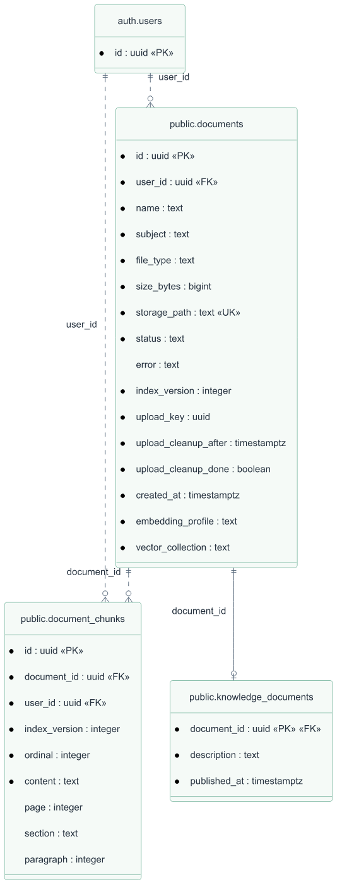
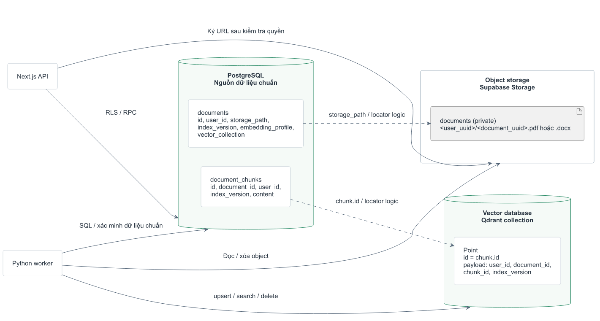
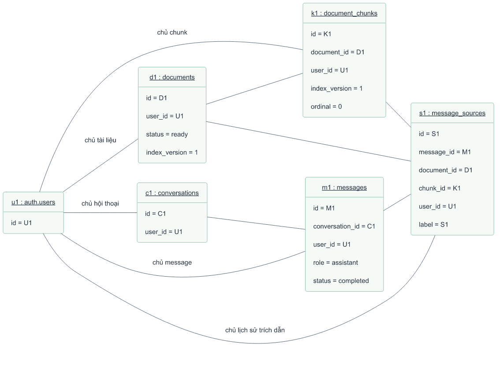

# Dữ liệu, lưu trữ và đối tượng LearnStep

Các sơ đồ dùng chung nguồn PlantUML trong docs/diagrams để tránh nhiều phiên
bản khác nhau. Xem [báo cáo đối chiếu với migration](diagram-review.md).

## ERD theo nhóm

- [Tài liệu](diagrams/04-erd.png): documents, chunks, registry nguồn chung.
- [Hội thoại và trích dẫn](diagrams/04a-conversation-erd.png).
- [Cộng đồng](diagrams/04b-community-erd.png).
- [Tài khoản và vận hành](diagrams/04c-operations-erd.png).

## Object storage và vector database

PostgreSQL giữ metadata, quyền, nội dung chunks, hội thoại và jobs; Supabase
Storage giữ PDF/DOCX gốc; Qdrant giữ vector và payload định vị. Locator giữa
các dịch vụ không có FK SQL. Worker kiểm tra dữ liệu chuẩn ở PostgreSQL.

Object storage là dịch vụ lưu tệp dạng object. Object database là cơ sở dữ
liệu hướng đối tượng; chưa có công nghệ đó trong mã hiện tại. Object diagram
bên dưới là sơ đồ instance, không phải thiết kế thêm một database.

## Object diagram

Đây là ví dụ minh họa sau một câu trả lời có nguồn, không phải dữ liệu thực.
Tên instance gạch chân theo dạng instance : classifier và thuộc tính có giá
trị cụ thể. Classifier ở đây là khái niệm được ánh xạ từ schema SQL; không suy
ra ứng dụng có lớp runtime tương ứng. Liên kết là các quan hệ giữa instance.

Các file SVG và nguồn sửa được nằm trong [danh mục sơ đồ](diagrams/README.md).
