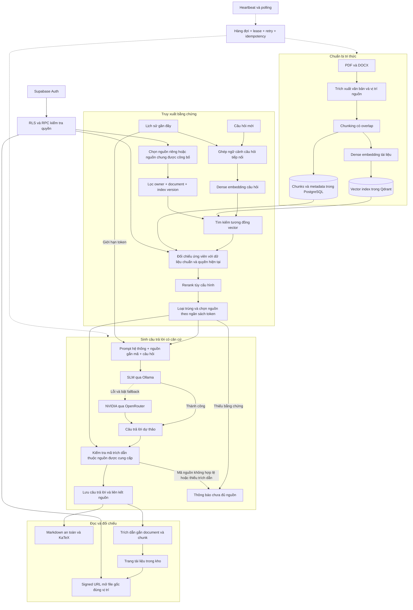

# Quan hệ giữa các kỹ thuật trong LearnStep

Đối chiếu pipeline hiện có ngày 2026-10-30. Sơ đồ tập trung vào quan hệ kỹ thuật,
không biểu diễn các tính năng dự kiến như OCR hoặc fine-tuning.

## Vai trò và mối liên hệ

| Kỹ thuật | Phụ thuộc hoặc hỗ trợ kỹ thuật khác |
|---|---|
| Trích xuất | Giữ trang PDF hoặc mục/đoạn DOCX để trích dẫn có thể dẫn về nguồn thật. |
| Chunking và overlap | Chia văn bản thành đơn vị truy xuất; overlap giảm mất ngữ cảnh tại ranh giới đoạn. |
| Dense embedding | Biến đoạn và câu hỏi thành vector trong cùng không gian embedding. Đổi model/profile cần index tương thích. |
| Vector retrieval | Tìm tối đa 8 ứng viên theo độ tương đồng, kết hợp bộ lọc quyền/document/version. Điểm tương đồng không phải xác suất đúng. |
| Kiểm tra dữ liệu chuẩn | Xác minh payload Qdrant với PostgreSQL, chặn nguồn sai quyền, bị thu hồi hoặc sai phiên bản. |
| Reranking | Có trong provider OpenRouter khi cấu hình; chế độ local và chat fallback hiện giữ nguyên thứ tự ứng viên, không gọi model rerank riêng. |
| Context budgeting | Loại trùng, chọn tối đa 5 đoạn, giới hạn lịch sử và dành token cho câu trả lời. |
| Prompt grounding | Yêu cầu trả lời từ nguồn, giải thích từng bước; nội dung tài liệu là dữ liệu tham khảo, không thay thế chỉ dẫn hệ thống. |
| Chat fallback | Thay model sinh câu trả lời khi model chính lỗi; chế độ này giữ embedding/truy xuất local và xóa phần sinh dở trước khi sinh lại. |
| Citation validation | Kiểm tra mã nguồn có nằm trong tập được cấp. Không tự chứng minh rằng mọi nhận định đều đúng hoặc được nguồn hỗ trợ về ngữ nghĩa. |
| Auth, RLS và RPC | Bảo vệ dữ liệu PostgreSQL/Storage; Qdrant cần bộ lọc riêng vì không kế thừa RLS. |
| Queue và idempotency | Tách tác vụ AI dài khỏi request Vercel; lease và retry hỗ trợ phục hồi, ID/key ổn định hạn chế ghi trùng. |
| Polling | Hiển thị trạng thái và nội dung đang sinh được lưu trong DB; không phải streaming trực tiếp từ model đến browser. |

RAG là chuỗi kết hợp **retrieval + context/prompt + generation**, không phải một
model riêng. Trong cấu hình ưu tiên local, BGE-M3 tạo embedding và Qwen sinh câu
trả lời qua Ollama; NVIDIA/OpenRouter là nhánh sinh dự phòng khi bật cấu hình.
Chế độ OpenRouter toàn phần có cấu hình embedding và rerank riêng.

Mã đối chiếu: `services/worker/src/study_worker/documents.py`, `models.py`,
`main.py`, `rag.py`, `fallback.py`, `openrouter.py`; quyền nguồn chung ở
`supabase/migrations/202610300001_document_repository.sql`.
